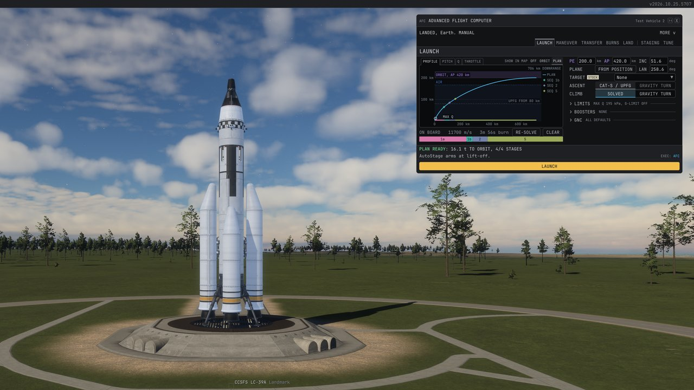
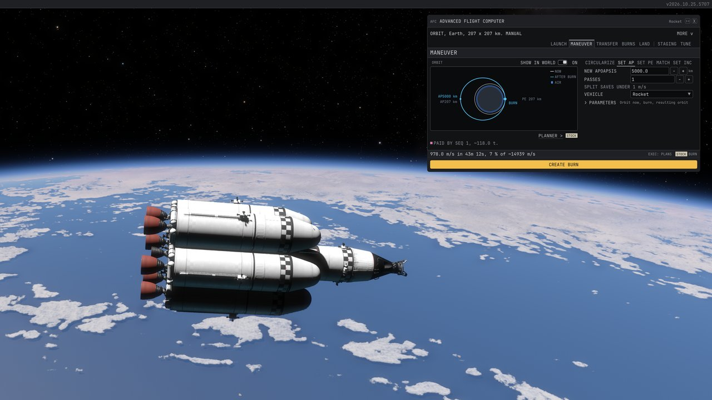
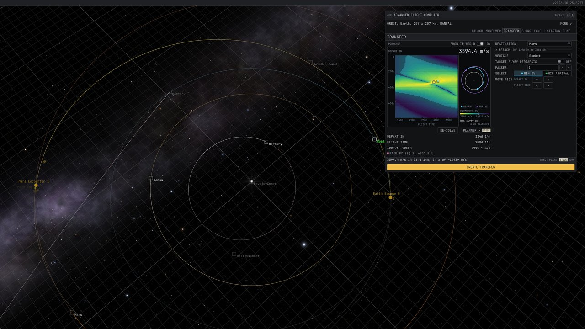
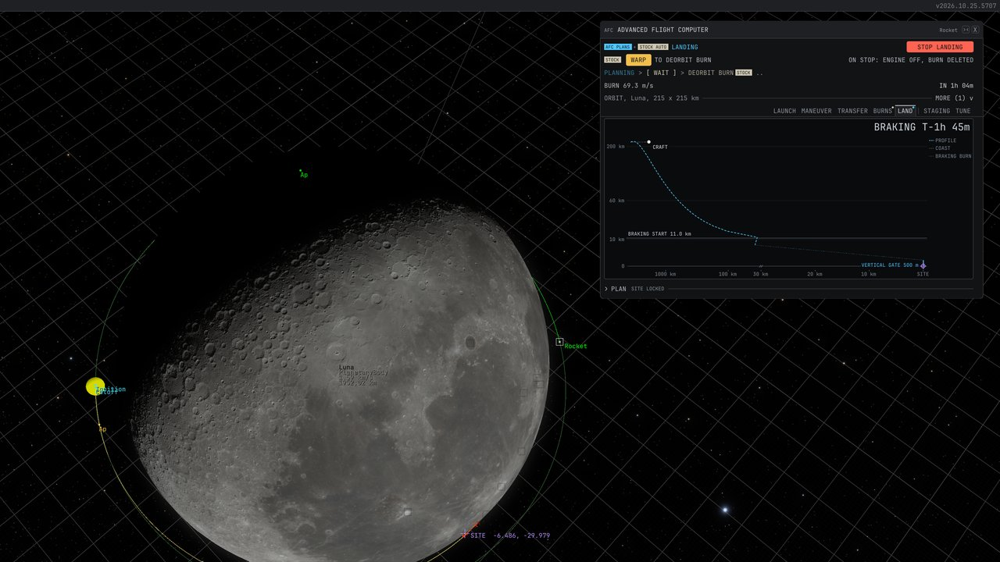
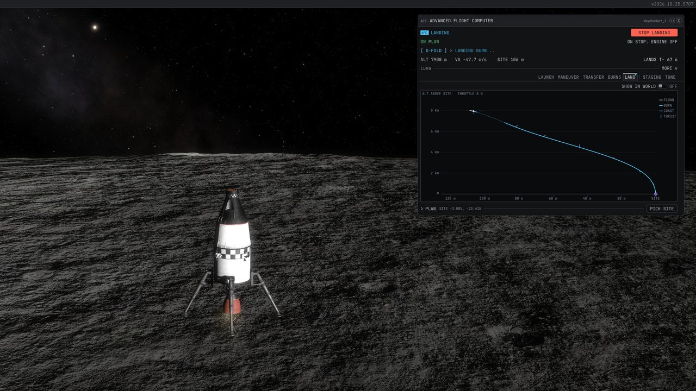
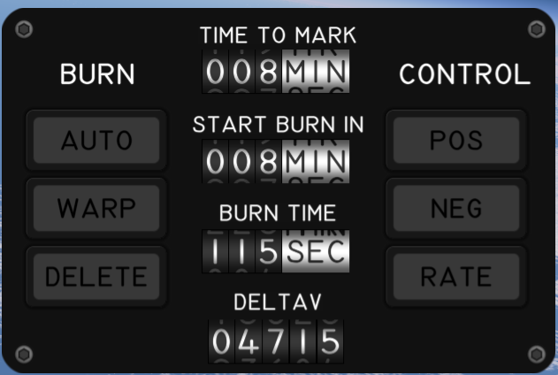
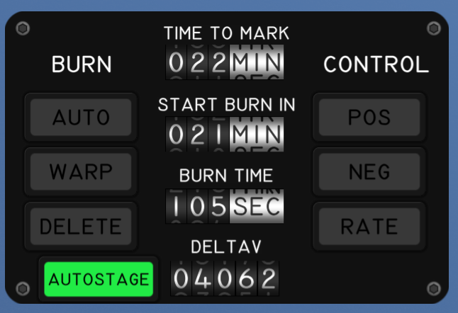
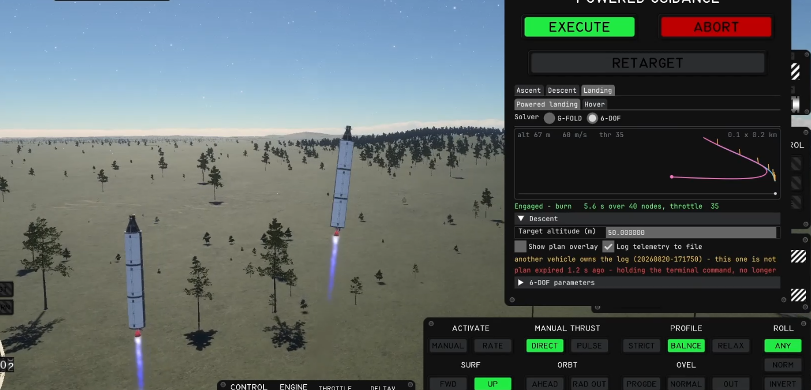

# AdvancedFlightComputer [](https://opensource.org/licenses/MIT)

Maneuver planning, burn execution and closed-loop guidance for [Kitten Space Agency](https://ahwoo.com/app/100000/kitten-space-agency).

Adds one AFC console for every feature, orbit quick-tools (circularize, set Pe/Ap, match/set inclination), flyby targeting so a Hohmann transfer arrives as a flyby instead of an impact, multi-pass burn splitting for Oberth-efficient departures, RCS-only burn execution, automatic staging with spent-booster drop and configurable staging delays, automatic removal of finished burns, and enables the planner to target interstellar comets on hyperbolic orbits (Oumuamua, 2I/Borisov, 3I/ATLAS).
Its powered guidance flies an ascent to orbit, a booster boostback and a pinpoint powered landing.

This mod is written against the [StarMap loader](https://github.com/StarMapLoader/StarMap).

Validated against KSA build version 2026.11.10.5801.

## The AFC console at a glance

One window holds every AFC feature. One row of tabs follows the order of a mission, the head says who flies the craft, and one button at the bottom commits the action that fits.



**LAUNCH** plans the climb on the pad and flies it with one press. The plan shows the profile, the stages and the margin.



**MANEUVER** sketches the orbit, the burn bars and the passes of a quick-tool, such as Set Apoapsis, before you create the burn.



**TRANSFER** plans a transfer window on an AFC porkchop plot and draws the transfer in the map.



**LAND** has four ways down: deorbit to a chosen site, boostback of a spent booster, landing from where the craft is, and hover.



The other pages are **BURNS** (how the next burn is flown, with RCS or the main engine), **STAGING** (AutoStage and the staging delays) and **TUNE** (the tuning values and the preferences). See [AFC Console](#afc-console) for the details.

## Features

### AFC Console

Every AFC feature that you start, watch or stop is in one window, the **AFC console**. **F4** and **View > Transfer Planner** open it, at the place where the stock Transfer Planner opens. The **AFC** menu in the top bar opens it too, with one item per page, and so do the AFC entries next to stock UI: the orbit right-click menu, the delays in the part window, and the RCS line under the burn editor.

The stock Transfer Planner stays as the game ships it. The **Planner** link with the STOCK chip on the **TRANSFER** page opens it, for example for **Interstellar**. Switch **F4 OPENS AFC** off on **TUNE > PREFERENCES** or in the **AFC** menu to give F4 and View > Transfer Planner back to the stock planner; the AFC menu still opens the console. In flight with no controlled craft, F4 opens the stock planner, and while the stock planner is open the console steps aside. If the console fails to draw again and again, for example after a game update, AFC gives F4 back to the stock planner for the rest of the session by itself.

One row of tabs under the head holds the seven pages in the order of a mission, with a hairline before the two setup pages. A dot after a tab means that something runs on that page:

- **LAUNCH** - the ascent: **ASCENT** and **CLIMB**, target orbit, launch window and the flight profile picture with the convex plan, the flown track and the staging ticks. Its **BOOSTERS** region sets the **SITE** each returnable stage flies home to after separation, and shows the **RESERVE** that the solved climb sizes for that stage.
- **MANEUVER** - the quick-tools below, with an orbit or plane sketch, the burn bars and the passes.
- **TRANSFER** - transfers to other bodies on an AFC porkchop plot, with passes, flyby targeting and a course correction.
- **BURNS** - how the next burn is flown (stock engine or RCS), with the RCS attitude and the propellant estimates.
- **LAND** - four ways down: **DEORBIT** (the whole chain from orbit), **BOOSTBACK** (a spent booster back to its site, with the return profile and the predicted impact), **LAND NOW** (the powered descent from where the craft is, with entry guidance, touchdown guidance or G-FOLD, as the **MODE** column of the solver table picks) and **HOVER**. Entry guidance can take a boostback glide over and fly the landing burn. Every way shares the landing site.
- **STAGING** - AutoStage, the staging delays and automatic burn removal.
- **TUNE** - the tuning values of every guidance mode, the diagnostics and the AFC preferences. Each set has the count of its changed values on its tab, and a changed value shows its default and a **RESET** on its row.

Every page has the same frame. While nothing runs, the head is one row that says where the craft is and who flies it: **LANDED**, **ORBIT**, **ASCENT** or **COAST**, **FALL** or **DESCENT**, or **ESCAPE**, with the name of the body. While something runs, the head shows who flies the controlled craft now (**AFC** in blue, **STOCK AUTO** outlined, **AFC PLANS + STOCK AUTO** with both, **MANUAL** in grey) with the one stop for what runs at its right: a guidance mode first, then an RCS burn, then a multi-pass, then a node that stock AUTO flies. Under it are the main numbers and the phase. A message row shows only with a message, and it clears when a new mode starts or a verb is pressed. Once nothing flies, a note leaves the head after 15 s and a warning after 30 s, and the drawer keeps them. Solver text stays on **TUNE > DIAG**. A warning row shows only while **AFC MAY STEER** or **AFC MAY USE ENGINES** is off. **MORE** in the head opens a drawer with the **GNC SWITCHES** of the craft (**AFC MAY STEER**, **AFC MAY USE ENGINES**, **AUTOSTAGE**), everything that runs with its own stop, the other craft under AFC and the message history. Under the tabs each page shows its name, then its inputs, its picture and its folds. A value that changes what the craft does stands on the page. A value that changes how well it flies is in a fold with a short name, such as **GNC**, **LIMITS** or **BOOSTERS**, and the label of a fold lists what it shows now. **PARAMETERS** holds readouts, and gains are on **TUNE**. The tooltip of every setting ends with how long its value is kept. The footer says what is true now and, in one sentence, what the commit will do, and holds the one commit of the page over the full width, for example **LAUNCH**, **BOOSTBACK**, **CREATE BURN** or **G-FOLD**. The end of the answer row says who flies after the click. On MANEUVER, TRANSFER and BURNS, **DELETE BURN** stands next to **FLY BURN**. A commit that would take the craft from another running guidance mode asks first.

All pages stay open for reading in every flight state, and the commit follows the situation. A gold verb fits where the craft is now. A verb that does not fit is a plain outline with the reason above it, for example **LAUNCH** in orbit with "Not on the ground", or **CREATE TRANSFER** with how much fuel is short. It still acts when you press it, unless a refusal stops it, and a link beside it can open the page that fits. While the mode of a page flies, that page has no verb, only the status of what flies. On TRANSFER the verb is **SOLVE** until a porkchop exists. On LAND a small ring marks the way that fits now. A craft that falls and opens the console for the first time in a flight opens on LAND.

The height of the window follows the page, with its top right corner fixed. It grows at once, and it shrinks only on a page change or when a fold closes, so a live value cannot make the footer jump. It stops above the stock autopilot panel, and a taller page first gives up picture height and then scrolls. The resize handle sets the maximum height, also past that panel. The icon beside the **X** makes the console **WIDE**, with the picture at the left and the inputs at the right. A page with no picture, such as **TUNE**, keeps the narrow window. Close the console with its **X** or F4. While AFC flies the craft, the head stays on screen as a strip with the stop, and **Open AFC** at the left of its bottom line brings the page of the running mode back. The page, the WIDE state and the window position are saved to `ui.toml` in the mod folder, and **RESET WINDOW POSITION** in the AFC menu docks the console again.

A real failure shows one red band under the stock altitude counter, also with the console closed: what happened, what the engine does, who flies and the time to impact when it is known. It stays until you press **OK**, and the strip stays with it. A failure is a mode that gave up while the craft still needs flying, or a mode that stays with no plan for 10 s. A normal end, a take-over by you or by stock AUTO, and a short state with no plan raise no band.

### Maneuver Quick-Tools

On the **MANEUVER** page of the console:

- **Circularize** - at apoapsis or periapsis.
- **Set Periapsis / Set Apoapsis** - single burn at the opposite apse to raise or lower one apse to a target altitude.
- **Match Inclination** - plane-change burn at AN or DN to align with a target orbit's plane. The target starts on the craft's own target, and **SET AS CRAFT TARGET** in **GNC** makes the picked one the craft's target.
- **Set Inclination** - plane-change burn at AN or DN to set an absolute inclination angle. The reference plane is selectable: **Equatorial** (parent body's equator, which matches `Orbit.Inclination`, because KSA's CCI +Z is the spin axis of the body) or **Ecliptic** (the plane of the system, KSA's CCE +Z). The row starts on **Equatorial**. For Earth the two differ by the ~23.4 degree obliquity.

The page starts on **Circularize**, or on **Set Apoapsis** when the orbit is already circular. A target field starts on an even value that differs from the orbit now, and it gets a new value when the situation, the body or the planned burns change. After **CREATE BURN** the page shows the burn that was made, with **FLY BURN** and **DELETE BURN** in the footer and **NEXT TOOL** to plan another burn from the orbit after it. **FLIGHT PLAN** is in the **PARAMETERS** fold.

When an action ends, the head offers one next step with a link: **CIRCULARIZE** after the ascent, the next pass after a pass, the orbit and **MANEUVER** after a burn. The console does not change page by itself.

Right-click the controlled vehicle's orbit and open **Advanced Flight Computer** to select a quick-tool.
The **At Periapsis** submenu offers **AFC: Set Apoapsis...**, and **At Apoapsis** offers **AFC: Set Periapsis...**.
These shortcuts open the console on **MANEUVER** with the tool selected, and they do not place a burn at the clicked point.
The stock Transfer Planner keeps its own plan types, including its own **Circularize**.

Quick-tools can plan a single burn after the last planned burn that changes the trajectory.
For example, plan a burn to raise apoapsis, then use **Set Periapsis** on the resulting orbit.
The preview and created node use that post-burn trajectory.
Multi-pass cannot start on a pending burn's trajectory.
Shortcuts wait until an active multi-pass execution has finished.

### Flyby Targeting

The stock planner aims every transfer at the target body's center, so a well-timed Hohmann arrives as an impact and the flyby has to be set up afterwards as a separate correction. Tick **TARGET FLYBY PERIAPSIS** on the **TRANSFER** page of the console and the departure burn is aimed to arrive at a periapsis you choose instead, so **CREATE FLYBY DEPARTURE** fires the flyby directly.

- **Periapsis** is entered against a selectable **REFERENCE**: **Surface** (altitude above the mean radius), **Center** (radius straight from the body center), or **Atmosphere** (altitude above the atmosphere boundary). The Atmosphere option only appears for bodies that have one, and a request below the safe floor is refused.
- **FLYBY SIDE** picks which side of the body you pass, named in the target's own orbital frame: **Inner** (toward its parent), **Outer** (away from it), **North**, or **South**. The aim offset has to stay perpendicular to the approach, so a side whose axis lies along the approach direction cannot be reached and is greyed out.
- Works for moon flybys and for interplanetary targets, either as a single burn or split across multi-pass passes.
- The page reports the approach speed, the impact parameter, the departure delta-V next to the impact-aimed one, and the periapsis the propagated trajectory actually reaches. The side column of the picture shows the flyby from above the target, and **SHOW IN WORLD** draws the retargeted trajectory in the world.
- For multiple passes, the readout uses the selected departure after any schedule shift and the periapsis from the final preview trajectory.
- If propagation cannot confirm a periapsis, the readout shows **No prediction** and its reason, such as a departure time outside the flight plan or no resolved target encounter.

**Limitations:**
- The plan is impulsive, the burn is not. On a near-escape departure the periapsis actually flown drifts from the requested one by roughly the finite-burn loss, on the order of one percent of a multi-km/s injection. Trim it with a small correction burn, or split the departure across several passes to cut the loss.

### Multi-Pass Burns

Any of the quick-tools and the transfers of the **TRANSFER** page can be split into multiple burns across successive orbits.
Instead of one long burn that sweeps a large arc away from periapsis, the engine fires in shorter bursts near periapsis on each orbit, reducing finite-burn loss.

**Maneuvers that can be split:**
- Hohmann transfers
- Set Periapsis / Set Apoapsis
- Match Inclination / Set Inclination
- Circularize at apoapsis / periapsis

**How to use:**
1. Select a tool on the **MANEUVER** page, or calculate and select a transfer on the **TRANSFER** page, and configure the maneuver as usual. The **PER PASS** choice is in the **GNC** fold of **MANEUVER** and **TRANSFER**.
2. Use the **PASSES** slider to choose how many passes (2-10). The burn bars under the picture show each pass and the stage that pays for it.
3. Click **CREATE n PASSES**. The first pass burn is placed in the burn plan.
4. Click **FLY BURN**, or enable **Auto** on the stock BURN gauge. Each pass fires automatically, with the main engine or as an RCS burn, and the next pass is scheduled after completion.
5. The head of the console shows the running passes and stops them with **STOP PASSES**.

**Why it helps:**
When burn duration is a significant fraction of the orbital period, a single burn wastes fuel by thrusting far from periapsis. Splitting across N passes keeps each burn near periapsis where the Oberth effect is strongest.
Real lunar kick stages use the same technique, several perigee burns instead of one long injection. It helps most for low-TWR spacecraft such as ion engines, small kick stages and nuclear tugs, where a single departure burn can take tens of minutes.

**Hands-free execution:**
Multi-pass works best with the built-in [automatic staging](#automatic-staging) switched on (handles staging between passes) and the built-in [automatic burn removal](#automatic-burn-removal) left on (cleans up completed burns). A multi-pass execution then runs hands-free from first ignition to final departure.

**Limitations:**
- Same-parent transfers (e.g., LEO to Luna) shift the final burn forward by a few parking periods to fit the K-schedule. The shift is shown under **PASSES** on **TRANSFER**.
- A change to the flyby side or altitude updates the selected departure even during thrust.
- Very high-energy departures from small SOIs (e.g., low Mars orbit to Saturn) may auto-clamp to fewer passes because intermediate orbits would escape the SOI.
- A pass that runs out of propellant waits in Manual so you can stage or refuel; if nothing aboard can thrust any more, the execution is cancelled with an alert.

### RCS Translation Burns

Execute a planned burn with RCS thrusters only, no main engine. Useful for small correction burns (rotating the whole vehicle for the main engine can cost more than just translating) and for vehicles without an active main engine like small probes.

- The stock **Auto** burn button is still the trigger, and **FLY BURN** in the footer of the **BURNS** page sends the same command: it executes the next burn with its resolved method. A burn resolves to the main engine when an active, fueled engine exists, otherwise to RCS; **BURN WITH** on the **BURNS** page sets a per-burn override (**ENGINE/RCS** or **RCS ONLY**), and **BURN WITH** on the docked block under the burn editor shows and cycles the same choice.
- Two attitude strategies, selectable per burn as **ATTITUDE** on the **BURNS** page while RCS flies the burn: **Hold** (keep the current attitude, fire the axis mix that points at the burn vector) and **Align** (rotate the strongest thruster axis onto the burn vector first). **FREE** (default) compares propellant estimates for both, including the slew cost, and picks the cheaper one.
- Execution is closed-loop against the game's own delta-V accounting: pulses shrink as the remaining delta-V approaches zero, and the burn stops inside the thrusters' minimum impulse of the target. The engine autopilot is suppressed for the whole run, so a misclick can never ignite the main engine on an RCS-armed burn.
- Burns themselves stay in the stock save format; removing the mod keeps every planned burn. The RCS arming metadata lives in `mods/AdvancedFlightComputer/rcs-exec.toml` next to the mod and survives save/load, including mid-burn.
- The **BURNS** page warns when a burn resolves to RCS but no thruster can translate (no propellant, none active) and when the estimated propellant exceeds what the thrusters can actually reach. Auto also shows an alert and refuses the burn before it creates execution state or changes the controls when the burn has no delta-V, no usable translation, or no axis that can serve its direction.
- The **BURNS** page lists every planned burn, and a press on a row picks it. **OPEN AFC** on the docked block under the burn editor and in the rendezvous burn infobox opens the page on that burn. The docked block shows **BURN WITH**, the state and **CANCEL** of a running RCS burn, and the warnings of its burn. Estimates for a later planned burn use the current vehicle as an approximation and say so on the **BURNS** page. Stock only loads the first executable burn as its active burn target, so these estimates do not forecast earlier burns or staging, and the footer verb shows only for the next burn.
- An RCS burn ends like an engine auto-burn: time warp stops, the game shows its alert and the next burn loads.
- The allocator is selectable per burn (default **BY AXIS**), as **THRUSTER MIX** in the **GNC** fold of **BURNS**. **BY AXIS** fires signed-axis groups and uses attitude control to counter residual torque. **MIN FUEL** solves a fuel-optimal jet-selection problem over individual thruster forces and torques, as a linear program (the Bergmann/Draper formulation). It can require costly counter-thrust, so it is opt-in, and it falls back to **BY AXIS** when the constraints are infeasible.

### Automatic Staging

<table>
  <tr>
    <th align="center">Stock</th>
    <th align="center">With AdvancedFlightComputer</th>
  </tr>
  <tr valign="top">
    <td></td>
    <td></td>
  </tr>
</table>

Activates the next sequence whenever the active engines run out of propellant, and drops burnt-out boosters while the rest of the stage keeps firing. Works during auto-burns (continues the burn instead of aborting) and manual burns. Do not install the standalone AutoStage mod next to AdvancedFlightComputer, because two stagers on one burnout would activate two sequences. The settings written by AutoStage are imported on the first load.

- **AUTOSTAGE toggle button** on the EngineControl gauge panel, in the free slot under RCS. The switch belongs to the vehicle, so an armed craft keeps staging when you control another one. The **AUTOSTAGE THIS CRAFT** switch at the top of the **STAGING** page of the console, the **AUTOSTAGE** switch in the head and in its drawer set the same switch.
- **Control-module guard** - a sequence that would separate the last control module is never staged automatically; stage it by hand if that is what you want.
- **Auto-burn continuation** - keeps the burn mode at Auto through staging, also when you stage by hand, so planned burns do not abort.
- **Cascade staging** - stages again if the next stage is empty or only has decouplers.
- **Spent stage drop** - sheds burnt-out boosters as soon as they quit, without waiting for the core stage to run dry.
- **Configurable staging delays** - independent delays for decouplers and engines, simulating separation and engine spool-up time.
- **On-screen countdowns** - "Decouple in X.Xs" and "Ignition in X.Xs" alerts during a delayed stage.

**Spent stage drop.** When solid boosters burn out before a liquid core, a trigger that waits for every engine to go dry would carry the empty casings along as dead mass. The mod therefore also stages when the next sequence would jettison nothing but burnt-out hardware: the sequence activates no engine, every active engine it separates is spent, an engine that stays with the vehicle is still firing, and nothing it separates is an engine that has never been activated. It refuses when the separated parts still hold propellant a retained engine can draw from, or when an enabled fuel link crosses the separation, so crossfeed setups are not cut off mid-burn. Turn it off with **DROP SPENT STAGES EARLY** on the **STAGING** page if staging should wait for a full burnout.

**Solid motors in the staging readout.** The game's staging model gives a solid motor the burn time of a full grain on every refresh, so a nearly spent booster is shown as a trickle that outlasts the core. The mod paces the motor at the mean flow of the burn it has left, read off its thrust curve, so the in-flight staging window and the guidance stage list end the booster phase where the boosters do.

**Staging delays.** Two delays are configurable per part variant, both measured from the staging trigger: the engine ignition delay (default values per stock engine variant, the small EngineA1 ignites after 2 s, EngineA3 after 3 s) and the decoupler delay (default 0 s, which matches stock). Set the decoupler delay shorter than the engine delay if the lower stage should drop away before the upper stage lights up.

- **STAGING page of the console:** the switches, and in the **DELAYS** fold the delays of this craft per sequence, the default delays of the parts of this craft, and under **ALL PARTS** the "ENGINE IGNITION DELAYS" and "DECOUPLER DELAYS" tables of every known part variant, with a filter. Every setting takes effect immediately; click **SAVE DEFAULTS** to persist the defaults. In the editor the page holds the defaults only.
- **Part window (right-click part > Window):** override the delay for a specific sequence on the current vehicle, or open the STAGING page with **OPEN AFC**. A part gets one block per sequence it fires something in, each naming the module it covers. Per-vehicle overrides take priority over the global config.

The global config is `Documents\My Games\Kitten Space Agency\mods\AdvancedFlightComputer\autostage.toml`:

```toml
[staging]
drop_spent_stages = true

[engine_delays]
CorePropulsionA_Prefab_EngineA2 = 2.0
CorePropulsionA_Prefab_EngineA3 = 5.0

[decoupler_delays]
CoreFairingA_Prefab_Interstage3W3HB = 1.0
```

Per-vehicle sequence overrides are stored next to it in `autostage-vehicles\<vehicle-id>.toml`, created automatically when you set an override in the part window, with separate `[sequence_delays]` (engines) and `[decoupler_delays]` sections. Nothing is written to a game save.

### Automatic Burn Removal

KSA removes a finished auto-burn from the plan when another burn follows it, but keeps the last one. This feature removes that last finished burn, engine or RCS, on every vehicle. Manual burns and burns that stopped for lack of propellant stay in the plan. A switch saved by the old standalone AutoRemoveFinishedBurns mod is imported on the first load.

- **AUTO REMOVE FINISHED BURNS** on the **BURNS** page of the console, on by default, persisted in `Documents\My Games\Kitten Space Agency\mods\AdvancedFlightComputer\autoremove.toml`.

### Hyperbolic Targets

The stock Transfer Planner filters out bodies with eccentricity >= 1. This mod lets both the stock planner and the **TRANSFER** page target interstellar comets (Oumuamua, 2I/Borisov, 3I/ATLAS) by patching the time-of-flight and alignment math to handle unbound orbits. The mod also gives the comets a mass and a sphere of influence, which the planner needs to target a body.

### Powered Guidance

[](https://youtu.be/hSUcV6tx3oY)

Closed-loop guidance that flies the vehicle for you, originally the [PoweredGuidance](https://github.com/cairn5/PoweredGuidance) mod by cairn5, see [Credits](#credits).
Use the **LAUNCH** and **LAND** pages of the [AFC console](#afc-console). The footer of the page starts its mode, and the stop in the head acts on the mode that runs, whatever page is on screen. **GUIDANCE ENABLED** in the **AFC** menu of the top bar and on **TUNE > PREFERENCES** switches guidance off and on.

- **Ascent** flies UPFG, the Space Shuttle's ascent guidance, to a target periapsis, apoapsis, inclination and LAN, optionally holding the argument of periapsis too and otherwise inserting wherever the burn costs least dV, with an optional launch window, g-limit and booster reserve. Launching to a target vehicle flies a co-elliptic chase orbit below it. Staging goes through [automatic staging](#automatic-staging), and a stage that separates with a command pod can get its own landing site.
- **Boostback** flies a separated booster back toward its landing site with a settling burn, a flip, the boostback burn and an entry attitude, against an impact prediction through the atmosphere.
- **Land from orbit** flies the whole chain from orbit: the deorbit burn, a powered descent with touchdown guidance (the 6-DOF solver) or G-FOLD (a point-mass solver and the fallback), and a terminal hover to touchdown.
- **Land from here** starts the landing from where the craft is now, with entry guidance, touchdown guidance or G-FOLD, as the **MODE** column of the solver table picks.
- **Entry guidance** (the 3-DOF solver) flies the glide through the atmosphere with the engine off, lights the engine at the planned ignition and flies the landing burn. With **ENTRY ON GLIDE** on, it takes a boostback glide over by itself, and with **TOUCHDOWN FOR BURN END** on, touchdown guidance takes the last seconds of the burn.

Guidance plans stay within the g-limit and the structural load limit at which KSA holds the throttle back.
Guidance takes a craft only when you press the commit of a page, and it lets go when you abort, take over the attitude or arm the stock Auto burn. A commit that would take the craft from another running guidance mode asks first.
An abort during the powered descent, the terminal hover or the landing burn of entry guidance leaves the engine as it is, so the craft does not drop, while every other abort cuts the engine. An abort of entry guidance in the glide cuts the engine, which is off in the glide in any case.
The hover refuses a craft whose thrust at minimum throttle exceeds its weight, because such a craft climbs whenever the engine runs, and a G-FOLD or touchdown guidance descent that would hand over to it flies its own plan to touchdown instead.
The aim of the hover is nudged with buttons. Numpad nudges are off by default, because the game also uses the numpad digits for its HUD layouts; **NUMPAD NUDGES THE HOVER** on **TUNE > PREFERENCES** turns them on. The keys then work while the craft hovers, whatever the console shows.
G-FOLD suits airless bodies and agile landers that point with RCS. Touchdown guidance (the 6-DOF solver) models the vehicle rotation, so it handles boosters with high rotational inertia and descents through an atmosphere.
The native solvers `clarabel_c.dll` and `scs.dll` ship with the mod. See the [guidance documentation](docs/guidance/README.md) for how it works.

## Installation

1. Install [StarMap](https://github.com/StarMapLoader/StarMap).
2. Download the latest release from the [Releases](https://github.com/Maximilian-Nesslauer/KSA-AdvancedFlightComputer/releases) tab.
3. Extract the zip into `Documents\My Games\Kitten Space Agency\mods\`. It already contains the `AdvancedFlightComputer` folder.
4. The game auto-discovers new mods and prompts you to enable them. Alternatively, add to `Documents\My Games\Kitten Space Agency\manifest.toml`:

```toml
[[mods]]
id = "AdvancedFlightComputer"
enabled = true
```

## Dependencies

| Package | Purpose | Tested version |
| --- | --- | --- |
| [StarMap](https://github.com/StarMapLoader/StarMap) | Mod loader, required at runtime (see [Installation](#installation)) | 0.4.6 |

## Build dependencies

Required only to build the mod from source. Targets **.NET 10**.

| Package | Source | Tested Version |
| --- | --- | --- |
| [StarMap.API](https://github.com/StarMapLoader/StarMap) | NuGet | 0.3.6 |
| [Lib.Harmony](https://www.nuget.org/packages/Lib.Harmony) | NuGet | 2.4.2 |

The native guidance solvers are built from the vendored sources with Rust and Zig, see [native-build.md](docs/guidance/native-build.md).

## Mod compatibility

- [AutoStage](https://github.com/Maximilian-Nesslauer/KSA-AutoStage), [AutoRemoveFinishedBurns](https://github.com/Maximilian-Nesslauer/KSA-AutoRemoveFinishedBurns) and [PoweredGuidance](https://github.com/cairn5/PoweredGuidance) are part of this mod. Delete their folders under `mods`, because KittenExtensions Continued applies the XML patches of a mod also when the mod is disabled.
- The AFC menu is in the top bar.
- Known conflicts: the standalone AutoStage and AutoRemoveFinishedBurns mods.

## Credits

- **Oliver Cairns ([cairn5](https://github.com/cairn5))** wrote [PoweredGuidance](https://github.com/cairn5/PoweredGuidance), which is the powered guidance in this mod: the UPFG ascent and its landing mode, G-FOLD, the CAT-S successive-convexification 6-DOF guidance, boostback, terminal hover, returnable stages, the impact prediction and the guidance panel. Its full history is part of this repository, and he is co-author of the project.
- **[PEGAS](https://github.com/Noiredd/PEGAS)** by Noiredd is the reference and foundation for the UPFG implementation; its MIT license is kept at [`third_party/pegas/LICENSE`](third_party/pegas/LICENSE).
- **G-FOLD** follows Acikmese and Ploen, *Convex Programming Approach to Powered Descent Guidance for Mars Landing* (2007), and Acikmese, Carson and Blackmore, *Lossless Convexification of Nonconvex Control Bound and Pointing Constraints of the Soft Landing Optimal Control Problem* (2013).
- **[Clarabel](https://github.com/oxfordcontrol/Clarabel.rs)** by Goulart and Chen and **[SCS](https://github.com/cvxgrp/scs)** by O'Donoghue are the conic solvers behind G-FOLD and the 6-DOF guidance.

## License

MIT - see [`LICENSE`](LICENSE). Vendored code under `third_party/` keeps its own upstream license.

PoweredGuidance releases up to and including **v0.3.1** linked [ECOS](https://github.com/embotech/ecos), which is GPLv3, and were therefore distributed under GPLv3 as a whole. Those releases stay available under GPLv3, but ECOS was replaced by Clarabel (Apache-2.0) before the import, so **nothing in the current tree is GPL**.

Attribution for the vendored solvers and their own transitive dependencies is in [`THIRD-PARTY-NOTICES.md`](THIRD-PARTY-NOTICES.md); all of them are permissive, and none impose copyleft on this work.

## Community

Thread on the KSA forums: https://forums.ahwoo.com/threads/advanced-flight-computer.783/

## Check out my other mods

- [DeltaVMap](https://github.com/Maximilian-Nesslauer/KSA-DeltaVMap) - interactive delta-v subway map and transfer-window planner, auto-generated from the loaded system ([forum thread](https://forums.ahwoo.com/threads/deltavmap.978/))
- [MeasureTools](https://github.com/Maximilian-Nesslauer/KSA-MeasureTools) - click-to-measure ruler, protractor, and surface measuring in the map view ([forum thread](https://forums.ahwoo.com/threads/measuretools.992/))
