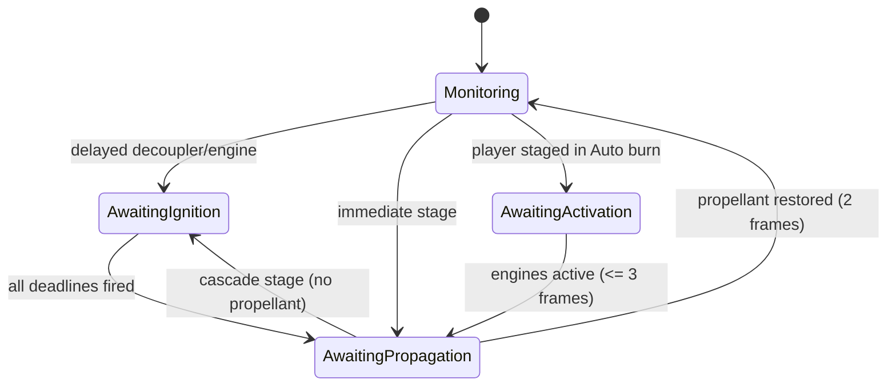

# AutoStage architecture

AutoStage (`AdvancedFlightComputer/Features/AutoStage/`) automates sequence activation on engine burnout, sheds spent boosters while a core keeps burning, releases stock payload fairings independently of engine staging, and enforces per-part / per-sequence decoupler and ignition delays.

## Per-vehicle state machine (`StagingDetector`)

`StagingDetector` tracks one `StagingState` per armed vehicle (including non-controlled craft) and for any vehicle where player-initiated staging occurs during a running stock Auto burn.
It hooks `Universe.ApplyVehicleSolvers()` via `Core/SharedVehicleHooks.ApplySolversPatch`:

- **Prefix (`StagingDetector.Sample`):** snapshots `SampledBurnMode` (`fc.BurnMode`) and `SampledHadPropellant` *before* vehicle solver outputs overwrite burn state.
- **Postfix (`StagingDetector.Evaluate`):** runs first inside `SharedVehicleHooks.TickVehicles` (ahead of MultiPass, RCS, FlybyCourse and TurnWarp) so taking back stock's out-of-propellant Auto stop happens before `FlightComputer.RaisePendingAlerts`.

- **`Monitoring`:** checks triggers in order: explicit `RequestStaging(vehicle)` (from guidance cues), burnout edge (`!hasPropellant && (SampledHadPropellant || AutoBurnStoppedOutOfPropellant)`), and spent-stage early drop (`TickSpentJettison` when `DropSpentStages` is enabled).
- **`AwaitingIgnition`:** ticks `PendingStaging` sim-time deadlines while calling `KeepAutoBurn` every frame.
- **`AwaitingActivation`:** holds Auto burn for up to `ActivationFrames = 3` frames after `OnPlayerStaged` until newly lit engines activate or separate.
- **`AwaitingPropagation`:** waits `PropagationFrames = 2` sim-advancing frames for `Rocket.UpdateRockets` to set `EngineControllerState.WasActive`, then either returns to `Monitoring` or triggers a **cascade stage** if no propellant is available and another engine sequence exists.

### Auto-burn preservation (`KeepAutoBurn` and `NewEngineSeedPatch`)

- `NewEngineSeedPatch` (`Vehicle.PrepareWorker(SimStep)` prefix) seeds `EngineControllerState.IsPropellantAvailable` on newly lit engines (`IsActive && !WasActive`) during Auto burns using `VehiclePropellant.IsFueled`, preventing a zero-thrust first worker frame without suppressing `Rocket.UpdateRockets`.
- `KeepAutoBurn` clears `AutoBurnStoppedOutOfPropellant`, `AutoBurnStageRanDry`, and `LastIgnitionDenied`, and calls `StockBurnMode.GiveBackAuto(vehicle, held, takesStopBack: true)` while the held `BurnTarget` stays loaded.
- If `!vehicle.IsControllable` or `VehicleControlOwnership.KfsOwns(vehicle)`, AutoStage disarms and cancels pending AFC work without altering stock sequence rows.

## Spent-stage drop, crossfeed and safety guards (`JettisonAnalysis`)

To drop empty side boosters while a core keeps burning without cutting crossfeed lines or stranding a craft, `TickSpentJettison` runs a two-stage gate:

1. **Shape cache (`GetPendingJettison`):** keyed on `(SequenceGeneration, Parts.Count, nextSequenceNumber)`. Refuses if the next sequence lights any `EngineController`, has no predictable `Decoupler`, or has an unpredictable tree split.
2. **Engine survey (`SurveyActiveEngines`) and dwell:** requires at least one spent active engine inside the jettisoned subtree, zero inactive/fueled/broken engines inside, at least one active thrusting engine staying aboard, and an incomplete burn. The condition must hold for `SpentJettisonDwellSeconds = 0.25 s` sim time.
3. **Live crossfeed and fuel-link check (`CarriesOffUsablePropellant`):** evaluated live after dwell; on refusal, restarts the dwell timer:
   - `FeedsStayingEngine`: scans fueled `Tank` modules inside the jettison subtree and checks `AvailableConsumers` against staying `EngineController` cores (intentionally ignoring RCS thrusters so recoverable booster pods do not block drop).
   - `CrossesFuelLink`: checks `vehicle.Parts.FuelLinks.Links` for any enabled fuel link crossing the jettison boundary.
4. **Control-module guard (`WouldSeparateLastControl`):** checked before both immediate staging and delayed decoupler firing via `StageControl.Evaluate`. If the craft would lose controllability, latches `HeldForControl = true`, alerts once, and releases `HeldBurn`.
5. **Separation clearance (`CanCascadeAfterSeparation`):** tracks `SeparatingRoots` from `StagingHooks.DecouplerActivating` and blocks subsequent cascade staging for `1.0 s` after all roots leave `vehicle.Parts` (or `2.5 s` deadline from the command).

### Solid-motor handling (`VehiclePropellant`)

Before querying propellant, `VehiclePropellant.IsFueled` calls `vehicle.Parts.EnsureDerived(DerivedData.SolidMotorStacks)` (because `ApplyVehicleSolvers` runs before `Program.PrepareFrame` flushes derived data).
`ComputePropellantAvailable(moleStates, isBurning)` counts remaining grain while burning and runs pressure equilibrium when quenched.
Any solid motor with `Stack.IsValid == false` increments `BrokenInside` and blocks spent-stage drop.

## Payload fairing release (`FairingJettison` and `FairingReleaseGate`)

`FairingJettison.Inspect` identifies stock radial aeroshroud rows (seven `CoreFairingA_Prefab_Aeroshroud*` templates attached as leaf children on stock radial decouplers with no engines, tanks, or control).
Pure fairing rows are skipped by `NextAutomaticSequence` during engine staging and released independently by the pure-logic `FairingReleaseGate`:

- Requires climbing (`dot(r, v) > 0`). On airless bodies, opens once `clearanceM >= 20 m` (`PadClearanceM`).
- In an atmosphere, tracks `_peakQ` and dwells when `q < 10 Pa` (`ThinAirPa`) or dynamic pressure is falling (`q <= _lastQ && _peakQ - q >= max(10, 0.01 * _peakQ)`). Opens after `FallSeconds = 0.25 s` once `q <= FairingQKpa` (default `3.0 kPa`) and `clearanceM >= max(20 m, FairingAltitudeKm)` (default `30 km`).
- On disarm or `1.0 s` release timeout, `ReturnToStock` restores passed-over rows to the stock staging key.

## Staging delays, persistence and patches

`StagingExecution.ActivateNextSequenceSplit` mirrors `SequenceList.ActivateNextSequence`, sorting modules by type (`EngineController` delayed by `GetSequenceEngineDelay`, `Decoupler` by `GetSequenceDecouplerDelay`, all others immediate) using sim-time `PendingStaging` deadlines.

- **Global config:** `<LocalMods>/AdvancedFlightComputer/autostage.toml` (`[staging]`, `[engine_delays]`, `[decoupler_delays]`), seeding default ignition delays (`1.5-3.0 s` for stock engines) and migrating legacy standalone AutoStage configs once.
- **Per-vehicle overrides:** `<LocalMods>/AdvancedFlightComputer/autostage-vehicles/<safeVehicleId>.toml` (`[sequence_delays]`, `[decoupler_delays]`). Nothing is written to KSA save files, and load-failure guards prevent overwriting unreadable TOML files.
- **Coexistence:** `AutoStageFeature.StandaloneModAbsent()` checks `GaugeButtonFlightComputer.EnumTypes` for `AutoStageToggle` and stands down if the standalone mod is installed.

## Code map

| File | Main type or method | Role |
| --- | --- | --- |
| [StagingDetector.cs](../../AdvancedFlightComputer/Features/AutoStage/StagingDetector.cs) | `Sample`, `Evaluate`, `RequestStaging`, `TickSpentJettison` | Per-vehicle state machine, burnout/cascade triggers, Auto-burn retention |
| [JettisonAnalysis.cs](../../AdvancedFlightComputer/Features/AutoStage/JettisonAnalysis.cs) | `GetPendingJettison`, `CarriesOffUsablePropellant`, `WouldSeparateLastControl` | Subtree split analysis, crossfeed/fuel-link/control guards |
| [StagingExecution.cs](../../AdvancedFlightComputer/Features/AutoStage/StagingExecution.cs) | `ActivateNextSequenceSplit`, `TickPendingStaging` | Delayed decoupler and engine activation |
| [FairingJettison.cs](../../AdvancedFlightComputer/Features/AutoStage/FairingJettison.cs) | `Inspect`, `NextAutomaticSequence`, `ReturnToStock` | Stock aeroshroud detection and independent release |
| [FairingReleaseGate.cs](../../AdvancedFlightComputer/Features/Ui/Logic/FairingReleaseGate.cs) | `FairingReleaseGate` | Pure-logic climbing, dynamic-pressure and clearance gate |
| [StagingConfig.cs](../../AdvancedFlightComputer/Features/AutoStage/StagingConfig.cs) | `StagingConfig` | Global and per-vehicle TOML delay persistence |
| [AutoStageFeature.cs](../../AdvancedFlightComputer/Features/AutoStage/AutoStageFeature.cs) | `ApplyPatches`, `StandaloneModAbsent` | Harmony patches for gauge button, sequence list, worker seed, part window |
| [VehiclePropellant.cs](../../AdvancedFlightComputer/Core/VehiclePropellant.cs) | `VehiclePropellant.IsFueled` | Shared liquid and solid-motor propellant availability check |
