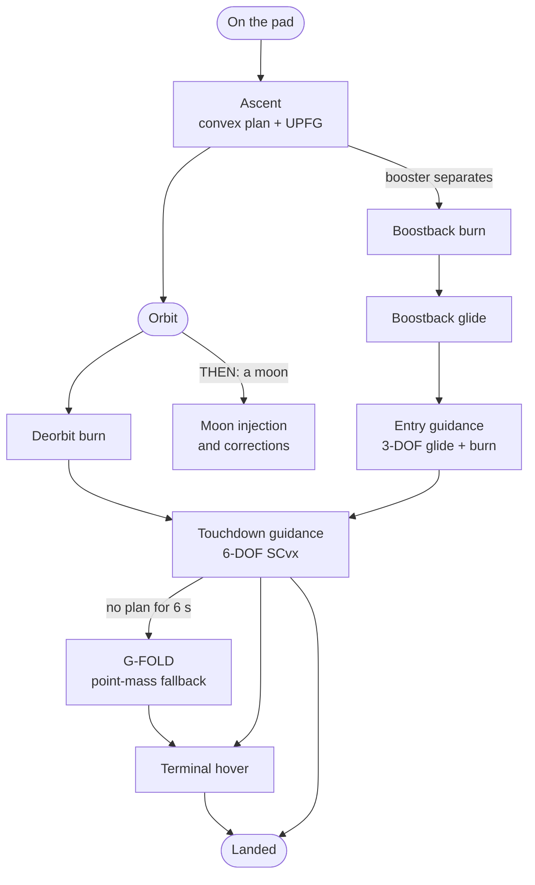

# Developer guide

This section explains how AFC works inside, for contributors and for anyone who wants to know why the craft does what it does.
The [User Guide](../user-guide/index.md) explains what each feature does from the player's side. Start there if a term here is new.

## How the code is laid out

Every feature lives in its own folder under `AdvancedFlightComputer/Features/`.

| Folder | What it does |
| --- | --- |
| `Ui` | The AFC console: its pages, the canvas pictures and the pure console rules. |
| `ManeuverTools` | The quick-tools on **MANEUVER**: circularize, set Pe/Ap, match and set inclination. |
| `MultiPass` | Splits a burn into passes near periapsis and flies them one after another. |
| `Transfer` | The **TRANSFER** page: porkchop plot, transfer commit, moon injection and course correction. |
| `Flyby` | Aims a transfer at a chosen flyby periapsis instead of the body centre. |
| `HyperbolicTargets` | Lets the planners target bodies on unbound orbits, such as interstellar comets. |
| `MissionPlanner` | The lunar launch planning behind **THEN** on **LAUNCH**: the launch plane and window. |
| `Burns` | Burn turn-warp checks and pointing warnings on planned stock burns. |
| `RcsTranslation` | Flies a planned burn with RCS thrusters only. |
| `RcsTorque` | Shares an attitude torque out among the RCS thrusters. |
| `AeroControl` | Shares an attitude torque out among the control surfaces (fins). |
| `AutoStage` | Automatic staging, the spent-stage drop and the staging delays. |
| `AutoRemove` | Removes the last finished burn from the plan. |
| `LandingSites` | Loads named landing sites from `AfcLandingSites.toml` across enabled mods. |
| `Guidance` | Powered guidance: ascent, boostback, entry and landing. See [AFC guidance](../guidance/README.md). |

Every write AFC makes to a craft's controls goes through one set of rules, described in [Control ownership](../control-ownership.md).

## The guidance chain

Each box is a guidance mode. An arrow is a hand-over from one mode to the next.

| Solver / subsystem | Where it is written up |
| --- | --- |
| What all three SCvx planners share (Clarabel persistent workspace, shared atmosphere & engine tables) | [Successive convexification](../guidance/scvx/index.md) |
| Convex ascent (SCvx), ballistic coast, UPFG and proportional energy cutoff | [Convex ascent](../guidance/scvx/ascent.md) and [UPFG & ascent hand-over](../guidance/upfg.md) |
| Boostback state machine, glide steering and returnable-stage reserve | [Boostback & reserve](../guidance/boostback.md) and [Impact steering](../guidance/reference-material/impact-steering.md) |
| Entry guidance, 3-DOF AL-SCvx (glide and burn) | [Entry (3-DOF)](../guidance/scvx/entry.md) |
| Touchdown guidance, 6-DOF SCvx (two-grid `vc-rv`, async `InitCold`, 2-term aero) | [Touchdown (6-DOF)](../guidance/scvx/touchdown.md), [on the craft](../guidance/scvx-bridge.md) and the [dev notes](../guidance/scvx-bridge-devnotes.md) |
| G-FOLD, the point-mass landing (node-0 bounds, free terminal thrust) | [G-FOLD](../guidance/gfold.md) |
| The attitude controller ($SO(3)$ axis-angle) and the gimbal (circular-cone), RCS and fin mixers | [Attitude control](../guidance/attitude/index.md) |
| AutoStage, spent-stage drop, fairing release and staging delays | [AutoStage architecture](autostage.md) |
| Quick-tools, multi-pass splitting, flyby targeting, lunar launch and turn-warp | [Maneuvers and transfers](maneuvers-and-transfers.md) |
| AFC console shell, pure UI logic (`Ui/Logic`) and test suites (`tests/`) | [Console and testing](console-and-testing.md) |

## Guidance subsystems and shared physics contract

All seven guidance subsystems (`AscentScvx`, `UPFG`, `Boostback`, `3-DOF Entry`, `G-FOLD`, `6-DOF Touchdown`, `Attitude & Allocators`) operate across three coordinate conventions - body-centred inertial (CCI) for ascent/UPFG/boostback, rotating Z-up `SiteFrame` for 3-DOF/6-DOF landings, and flat X-up `KsaGfold.Frame` for G-FOLD - while sharing one consistent physics snapshot (`GuidanceModelSnapshot`):

- **Altitude-varying atmosphere (`SampledAtmosphere`):** Speed of sound $a(h)$, dynamic viscosity $\mu(h)$ and Reynolds number $\operatorname{Re}(h)$ across all atmospheric planners.
- **Aero fidelity:** Exact closed-form mass-varying 2-term `MomentLimiter` and rotational aerodynamic damping $(C_{lp}, C_{mq}, C_{nr})$ shared across 6-DOF touchdown and attitude/fin control.
- **Engine back-pressure parity:** Differentiable 2D cubic B-spline `EngineThrustTable(u, P)` shared across 3-DOF entry and 6-DOF touchdown.
- **Conic solver & control arbiter:** Persistent `ClarabelWorkspace` + frozen-sparsity `CcsAssembler` across all SCvx solvers (SCS behind a switch), and single-owner actuator writes through `Core/VehicleCommandSink.cs`.

## Still to write

- Landing engine groups, idle engine parking, and landing-leg deployment timing
