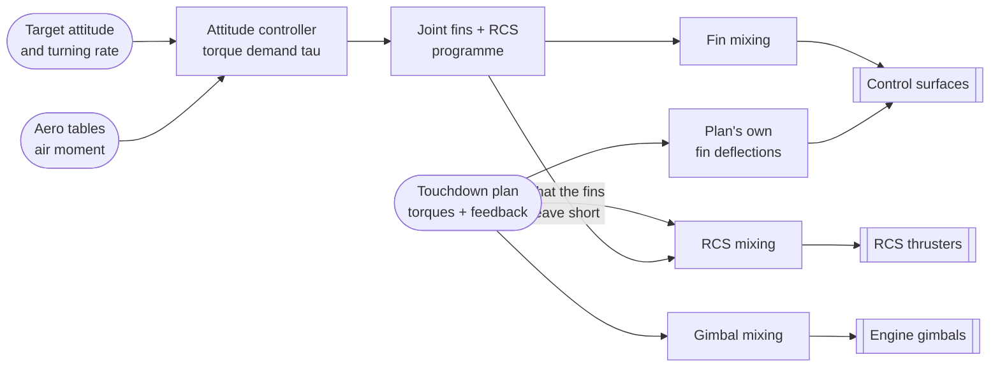

# Attitude control

AFC points a craft in one of two ways.
Most modes write an attitude target into the stock flight computer and let it steer.
A returning booster gliding with its engine off, and touchdown guidance, steer the craft themselves.
They work out a torque and spend it on the craft's actuators through AFC's own mixers.

This section covers AFC's own path:

- the **attitude controller**, which turns an attitude and rate error into a torque demand (this page);
- the **common torque-allocation problem**, which every mixer solves in its own way (this page);
- the three mixers: [gimbal mixing](gimbals.md), [RCS mixing](rcs.md) and [fin mixing](fins.md).

Who may write which control, and how AFC hands the craft back, is on [Vehicle control writes](../../control-ownership.md).

## Axes and symbols

All the controller's vectors are in the **model body axes** (`KsaFrameBridge.BodyAxes`): $x$ and $y$ across the craft, and $z$ along the thrust axis, which is the roll axis.
The same symbols are used on all four pages:

| Symbol | Meaning | Unit |
| --- | --- | --- |
| $\boldsymbol{\tau}$ | the torque demand | N m |
| $\mathbf{u}$ | the commands of one actuator family | depends on the family |
| $B$ | the effectiveness: torque per unit command, one column per command | N m per unit |
| $I$ | the inertia, diagonal in the model axes (`Ksa6DofSetup.Inertia`) | kg m^2 |
| $\boldsymbol{\omega}$ | the body rate | rad/s |
| $\boldsymbol{\theta}$ | the attitude error, a small rotation from the body onto the target | rad |
| $\omega_n$, $\zeta$ | the loop's natural frequency and damping ratio | rad/s, - |

## The control law

`AttitudeController.Step` runs once per guidance step on the main thread.
It reads the craft, builds a torque demand and commands the actuators.
The law is

$$
\boldsymbol{\tau} = I\,k_d\big(\boldsymbol{\omega}_c + \widetilde{\Delta\boldsymbol{\omega}}\big)
 + I\,k_i\,\omega_n^2 \int \boldsymbol{\theta}\,dt
 + \boldsymbol{\omega}\times I\boldsymbol{\omega}
 - \mathbf{M}_\text{air},
\qquad k_p = \omega_n^2,\quad k_d = 2\zeta\omega_n
$$

The four terms are the feedback, the integral, the gyroscopic term and the air-moment feed-forward.
$I\mathbf{v}$ means the diagonal inertia applied to each model-axis component of $\mathbf{v}$.

### Attitude error

The error is built from the target's three axes as the body sees them, $\mathbf{t}_i$, against the body's own axes $\mathbf{e}_i$:

$$
\boldsymbol{\theta} = \tfrac12 \sum_{i=1}^{3} \mathbf{e}_i \times \mathbf{t}_i = \sin\phi\;\mathbf{n}
$$

Here $\phi$ is the angle and $\mathbf{n}$ the axis of the rotation onto the target.
For small errors $\boldsymbol{\theta}$ is the rotation vector itself.
For large ones it saturates: its length peaks at 90 deg and falls back to zero for a target exactly behind.
The reported error is $\arcsin(\min(|\boldsymbol{\theta}|, 1))$, so it never reads more than 90 deg.

The error is split into a **roll** part along $z$ and a **pointing** part across it:

$$
\boldsymbol{\theta}_\text{roll} = (\boldsymbol{\theta}\cdot\hat{\mathbf z})\,\hat{\mathbf z},
\qquad
\boldsymbol{\theta}_\text{point} = \boldsymbol{\theta} - \boldsymbol{\theta}_\text{roll}
$$

### Rate error and its filter

The rate error is the target's turning rate, moved into body axes, less the body rate: $\Delta\boldsymbol{\omega} = \boldsymbol{\omega}_\text{target} - \boldsymbol{\omega}$.
It passes through a first-order lag of time constant $T_f$ (`RateFilterS`, 0.2 s):

$$
\widetilde{\Delta\boldsymbol{\omega}}_{k} = \widetilde{\Delta\boldsymbol{\omega}}_{k-1} + \frac{\Delta t}{T_f + \Delta t}\big(\Delta\boldsymbol{\omega}_k - \widetilde{\Delta\boldsymbol{\omega}}_{k-1}\big)
$$

$\Delta t$ is the simulation time since the last step, clamped to 0...0.2 s.
The first step after an engage starts the filter on the raw value.
On the flown booster the raw rate error carried 0.5 deg/s of wobble, about 10 kN m of demand jittering through its inertia, and the fins chased it.

### Capture rate

Without a cap, the feedback is the usual PD, $I(k_p\boldsymbol{\theta} + k_d\Delta\boldsymbol{\omega})$.
The code writes the proportional part as a rate, $\boldsymbol{\omega}_c = (k_p/k_d)\,\boldsymbol{\theta}$, and caps that rate at $\omega_\text{max}$ (`CaptureRateDegS`, 5 deg/s).
The cap is applied to pointing and roll **separately**:

$$
\boldsymbol{\omega}_c = \operatorname{sat}_{\omega_\text{max}}\!\Big(\frac{k_p}{k_d}\boldsymbol{\theta}_\text{point}\Big) + \operatorname{sat}_{\omega_\text{max}}\!\Big(\frac{k_p}{k_d}\boldsymbol{\theta}_\text{roll}\Big),
\qquad
\operatorname{sat}_{m}(\mathbf v) = \mathbf v \min\!\Big(1, \frac{m}{|\mathbf v|}\Big)
$$

So a large error is closed at a set rate rather than at the actuators' full torque.
With the defaults the cap binds above about 8 deg of error.
One cap on the whole vector starved the pointing: a booster 73 deg off in roll and 5 deg off in pointing closed the pointing at 0.3 deg/s, and the roll took 18 s.

### Integral

The integral learns the part of the air's moment that the feed-forward misses (17 % on one flight), so the error settles instead of standing at a degree.

- The pointing error is integrated only while $|\boldsymbol{\theta}_\text{point}| < \theta_\text{int}$, and the roll error only while $|\boldsymbol{\theta}_\text{roll}| < \theta_\text{int}$ (`IntegralWithinDeg`, 3 deg).
- The integral's length is capped at 8 deg s (`IntegralMaxDegS`).
- Its gain is $k_i\,\omega_n^2$ with $k_i$ = `IntegralPerS`, 0.1 /s.

It keeps acting inside the deadband.

### Air-moment feed-forward

`AttitudeController.TryAirMoment` reads the aero sweep's body moment table at the Mach number, $\alpha$ and $\beta$ flown now:

$$
\mathbf{M}_\text{air} = \frac{q S L\,\mathbf{C}_M(\text{Mach},\alpha,\beta) + (\mathbf r_\text{sweep} - \mathbf r_\text{now}) \times q S\,\mathbf{C}_F(\text{Mach},\alpha,\beta)}{1 + k\,q}
$$

- $q$ is the dynamic pressure, $S$ and $L$ the reference area and length, $\mathbf{C}_M$ and $\mathbf{C}_F$ the moment and force coefficients.
- The second term moves the moment from the centre of mass the sweep saw to the present one.
- $k$ is the game's moment limiter per pascal (`BodyAero6Dof.MomentLimiterPerPa`), measured on the craft. The integrator divides the air's whole moment by $1 + kq$, so the prediction does too.

The angles are engine first: with $\hat{\mathbf u}$ the craft's velocity through the air in body axes, $\alpha = \operatorname{atan2}(u_z, -u_x)$ and $\beta = \operatorname{atan2}(u_y, -u_x)$.
There is no feed-forward below 50 Pa, below 1 m/s, nose first, or outside $|\alpha|, |\beta| \le 20^\circ$, the edge of the tables.
The report's `AirKnown` says which.

The feed-forward cancels the air's moment before any error builds.
That is the reason for this controller: the stock flight computer knows nothing of the air, so on a booster gliding a few degrees off the airflow it fired its RCS every way, all the time, and held a standing error.

### Gyroscopic term

$\boldsymbol{\omega}\times I\boldsymbol{\omega}$ cancels the torque-free coupling between axes in Euler's equation, $I\dot{\boldsymbol\omega} = \boldsymbol\tau_\text{applied} - \boldsymbol\omega\times I\boldsymbol\omega$.

### Deadband

The deadband is **off by default** (`DeadbandDeg` 0).
When it is on, the feedback stands down while the error is under half the deadband and the rate error under `RateDeadbandDegS` (0.5 deg/s).
It comes back once the error passes the whole deadband or the rate error passes twice that rate.
Only the feed-forward and the integral fly in between.
It is off because each return of the feedback kicked: in the harness a 0.5 deg deadband cost 50 kg of RCS propellant holding a tilt that cost 46 kg without one, and 1 deg cost 234 kg.

### Settings

`AttitudeController.Settings`, with the values the glides fly:

| Field | Default | Meaning |
| --- | --- | --- |
| `BandwidthRadS` | 1.0 | $\omega_n$; the glides take it from `VehicleAutopilotState.AttitudeBandwidthRadS` |
| `Damping` | 0.8 | $\zeta$ |
| `DeadbandDeg` | 0 | the deadband; from `AttitudeDeadbandDeg` |
| `RateDeadbandDegS` | 0.5 | the rate side of the deadband |
| `IntegralPerS` | 0.1 | $k_i$ |
| `CaptureRateDegS` | 5.0 | $\omega_\text{max}$ |
| `RateFilterS` | 0.2 | $T_f$ |
| `IntegralWithinDeg` | 3.0 | $\theta_\text{int}$ |
| `IntegralMaxDegS` | 8.0 | the integral's cap, deg s |

<!-- viz: attitude-controller 620 -->
*Start the craft 73 deg off in roll and 5 deg off in pointing, switch the split capture cap on and off, and change the feed-forward's error to watch the integral take up the rest.*

### What you see in flight

- A large error closes at a steady 5 deg/s, pointing and roll at the same time, rather than with a burst of RCS.
- On a glide the craft holds within a fraction of a degree after a few seconds, once the integral has learned what the tables miss.
- When the feed-forward has no table (too little air, or more than 20 deg off engine first), the craft holds on feedback alone and sits with a small standing error until the integral catches up.

## The common torque-allocation problem

Every mixer answers the same two questions for its own actuators.
What commands give this torque?
And how much torque can they give about each axis, each way?
This part sets up the shared problem; each mixer page shows how it fills it in.

### Effectors and effectiveness

An **effector** is one thing the mixer can command: a thruster's duty, a fin segment's travel, one axis of one gimbal.
Its **effectiveness** is the torque one unit of command gives, a column of $B$.
For $m$ commands,

$$
\boldsymbol{\tau}_\text{given} = B\,\mathbf{u}, \qquad B \in \mathbb{R}^{3\times m}
$$

$B$ is linear in the commands, or made so: the RCS is exactly linear in duty, the fins are linear on each segment of their curves, and the gimbals are linearised about rest.
Each effector usually brings a **side force** with its torque, $F\,\mathbf u$.
No mixer constrains it: a thruster at one end of a booster cannot turn it without pushing it sideways.
The mixers report it, and the planners that need it model it.

### Command bounds

Every command is bounded:

$$
\mathbf{u}_\text{min} \le \mathbf{u} \le \mathbf{u}_\text{max}
$$

| Family | Command | Bounds |
| --- | --- | --- |
| RCS | duty $d_i$, the share of the control period thruster $i$ fires | $0 \le d_i \le 1$ |
| Fins | travel along one segment of a fin's curve | 0 to the segment's width, inside what the fin reaches by the next step |
| Gimbals | normalised deflection per gimbal axis | $-1 \le u \le 1$, a fraction of the gimbal's range |

### Attainable torque

The **attainable torque set** is every torque the bounds allow:

$$
\mathcal{A} = \{\, B\mathbf u : \mathbf u_\text{min} \le \mathbf u \le \mathbf u_\text{max} \,\}
$$

A box mapped through a linear map is a convex polytope (a zonotope).
A demand inside $\mathcal{A}$ can be met exactly; a demand outside it cannot, and the mixer must choose which part to give up.

<!-- viz: attainable-torque 620 -->
*Pick a family and a plane of axes, drag the demand outside the attainable set, and change the axis priorities to see which axis gives way.*

### The allocation as a linear programme

The RCS and the fins solve one linear programme per call.
The shortfall $\mathbf e^{+}, \mathbf e^{-} \ge 0$ is the part of each axis's demand left unmet, one way and the other:

$$
\begin{aligned}
\min_{\mathbf u,\,\mathbf e^{\pm}}\quad & \mathbf c^\mathsf{T}\mathbf u + \sum_{a\in\{x,y,z\}} p\,w_a\,(e^{+}_a + e^{-}_a) \\
\text{s.t.}\quad & B\,\mathbf u + \mathbf e^{+} - \mathbf e^{-} = \boldsymbol{\tau} \\
& \mathbf u_\text{min} \le \mathbf u \le \mathbf u_\text{max},\quad \mathbf e^{\pm} \ge 0
\end{aligned}
$$

- $\mathbf c$ is the cost of each command: propellant for a thruster, a small price per degree for a fin.
- $p$ is the price of one newton metre of shortfall, set far above any command's cost per newton metre. So the mixer gives all it can before any demand goes unmet, and among the ways to meet it picks the cheapest.
- $w_a$ is the axis priority. When the demand is out of reach, the axis with the smallest weight gives way first.

The attitude controller and touchdown guidance both use $\mathbf w = (1, 1, 0.3)$: pitch and yaw before roll.

The bounds are written as equalities with slacks, $u_j + s_j = u_{\text{max},j}$, so the solver sees the standard form $\min \mathbf c^\mathsf T \mathbf x$, $A\mathbf x = \mathbf b$, $\mathbf x \ge 0$.
`RcsLpSolver.Solve` solves it with a two-phase simplex and Bland's rule; it is the jet-select programme of Bergmann and Weiler (AIAA 1983-2209).

The gimbals do not use a linear programme.
They use a regularised minimum-norm solve with a saturation cascade, which has a closed form and runs on the vehicle worker every control step; see [Gimbal mixing](gimbals.md).

### How families are combined

- **Fins and RCS share one programme.** The attitude controller gives the fins' programme the RCS thrusters as extra **backup columns**: each thruster's full-duty torque, bounded 0...1, priced by its propellant. A degree of fin costs about a thousandth of a newton metre of shortfall, the best thruster 0.02 per newton metre. So the fins take every axis they can, the RCS takes what they cannot, and only then does any demand go unmet. Roll included: a fixed "fins first, roll last" order had left roll to the RCS where the fins could have taken it.
- **The RCS is then solved again on its own** for what the fins will really give short of the demand, $\boldsymbol\tau - \boldsymbol\tau_\text{fins}$. The joint programme's duties are not flown; they only shape what the fins take.
- **The gimbals are separate.** In the current build the attitude controller flies a craft with its engine off and never uses them. Touchdown guidance commands the gimbals and the RCS each with the plan's own torque, and its attitude feedback ([`AttitudeFeedback6Dof`](#where-the-controller-is-used)) shares its correction between them in proportion to the room each has left.

### Characterise: reach per axis each way

Each mixer can also **characterise** itself: for each axis $a$ and sign $\sigma = \pm1$ it finds the largest pure torque with the other two axes held at zero,

$$
\max_{t,\,\mathbf u}\; t \quad \text{s.t.}\quad B\mathbf u = \sigma\,t\,\hat{\mathbf e}_a,\quad \mathbf u_\text{min}\le\mathbf u\le\mathbf u_\text{max}
$$

with a tiny command cost so that a tie goes to the cheaper pattern.
It then allocates half of that reach and reports what each newton metre costs there: the propellant for the RCS, the side force for the RCS and the fins.
That gives six numbers per family, +x, -x, +y, -y, +z, -z, and planners use them: touchdown guidance builds its RCS model from the RCS's six (`Ksa6DofSetup.RcsModel`).
For the gimbals the equivalent is asking the allocator for far more torque than it has and reading back what it gives (`Ksa6DofSetup.TorqueAlong`).

## Where the controller is used

| Phase | Torque from | Mixers | Notes |
| --- | --- | --- | --- |
| Entry guidance's glide ([entry](../scvx/entry.md)) | `AttitudeController` | fins + RCS | `ThreeDofOwnAttitude`, on by default. Entry's own trim is off while it flies. |
| Boostback's glide, engine off | `AttitudeController` | fins + RCS | `BoostbackGlideOwnAttitude`, on by default |
| Touchdown guidance ([touchdown](../scvx/touchdown.md)) | the plan's torques plus `AttitudeFeedback6Dof` | gimbals, RCS; fins at the plan's own deflections | the coast before ignition flies the plan's RCS torque alone |
| Ascent, boostback burn, deorbit, landing burns | stock flight computer | stock gimbals and RCS | AFC writes the target and its turning rate |

`GuidanceWindow.OwnsGlideAttitude` decides each step whether the controller flies.
While it does, the stock flight computer is held at Manual so it steers nothing, and the first step it does not fly, `AttitudeController.Release` sends the fins home and lets the RCS go.
A glide holding a fixed roll may also turn that roll, at a limited rate, towards the nearest roll at which the air's rolling moment trims (`AttitudeController.TryLeastRollMoment`), and only for a real gain.

Touchdown guidance has its own law, `AttitudeFeedback6Dof`, on top of an open-loop plan:

$$
\boldsymbol\tau_\text{fb} = -I\big(\omega_n^2\,\boldsymbol\theta + 2\zeta\omega_n(\boldsymbol\omega - \boldsymbol\omega_\text{plan}) + k_i\textstyle\int\boldsymbol\theta\,dt\big),
\qquad \omega_n = 1.5\ \text{rad/s},\ \zeta = 0.8,\ k_i = 0.25\,\omega_n^3
$$

with $\boldsymbol\theta$ the error against the plan's attitude at the same instant.
The plans keep back a share of each actuator (`SixDofTorqueMargin`, 20 %) for it.
The correction goes to the gimbals and the RCS in proportion to the room each has left: the gimbals' cone around the plan's lateral torque, their roll range, and the RCS's box.
A correction larger than both together is cut to fit.

Where the stock flight computer steers, AFC still shapes what it does:

- `KsaAttitudeRate` adds the target's own turning rate to the flight computer's target, so it tracks a moving target instead of chasing a string of stationary ones.
- `AttitudeOwnership` records the attitude settings guidance writes and gives back the player's on release, if nobody has changed them since.
- During a landing burn that the flight computer steers, `GuidanceWindow.SteerLandingBurnWithGimbal` switches RCS off while the gimbals hold both pitch and yaw, so the gimbals alone point the craft.

The rules for these writes are on [Vehicle control writes](../../control-ownership.md#guidance-control).

## Code map

| File | Main type or method |
| --- | --- |
| [AttitudeController.cs](../../../AdvancedFlightComputer/Features/Guidance/Control/AttitudeController.cs) | `AttitudeController.Step`, `TryAirMoment`, `TryLeastRollMoment`, `Settings` |
| [AttitudeRate.cs](../../../AdvancedFlightComputer/Features/Guidance/Control/AttitudeRate.cs) | `KsaAttitudeRate.Set`, `OnUpdateAttitudeTarget` |
| [AttitudeOwnership.cs](../../../AdvancedFlightComputer/Features/Guidance/Control/AttitudeOwnership.cs) | `AttitudeOwnership.Release` |
| [AttitudeFeedback6Dof.cs](../../../AdvancedFlightComputer/Features/Guidance/Adapters/Scvx/SixDof/AttitudeFeedback6Dof.cs) | `AttitudeFeedback6Dof.Correct` |
| [Autopilot.cs](../../../AdvancedFlightComputer/Features/Guidance/Modes/Autopilot.cs) | `GuidanceWindow.OwnsGlideAttitude`, `FlyOwnAttitude`, `StopOwnAttitude`, `SteerLandingBurnWithGimbal` |
| [ThreeDof.cs](../../../AdvancedFlightComputer/Features/Guidance/Modes/ThreeDof.cs) | entry guidance's glide, which hands its attitude to the controller |
| [BoostbackGlide.cs](../../../AdvancedFlightComputer/Features/Guidance/Modes/BoostbackGlide.cs) | the boostback's glide, the same |
| [SixDof.cs](../../../AdvancedFlightComputer/Features/Guidance/Modes/SixDof.cs) | `GuidanceWindow.ApplyPlanCommand`, `FlyPlanRcs`, `FlyPlanFins` |
| [VehicleAutopilotState.cs](../../../AdvancedFlightComputer/Features/Guidance/Modes/VehicleAutopilotState.cs) | `ThreeDofOwnAttitude`, `BoostbackGlideOwnAttitude`, `AttitudeBandwidthRadS`, `SixDofTorqueMargin` |
| [RcsLpSolver.cs](../../../AdvancedFlightComputer/Features/RcsTranslation/RcsLpSolver.cs) | `RcsLpSolver.Solve`, the simplex every programme here runs on |
| [KsaAeroSweep.cs](../../../AdvancedFlightComputer/Features/Guidance/Adapters/KsaAeroSweep.cs) | `KsaAeroSweep.Result`: the body moment table and the fin tables |
