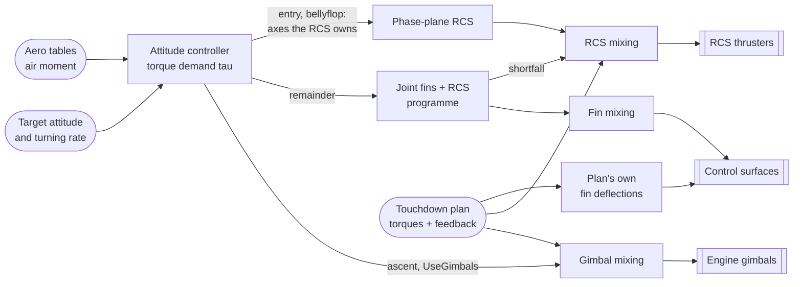

# Attitude control

AFC points a craft in one of two ways.
Some modes write an attitude target into the stock flight computer and let it steer.
Ascent (by default, `AscentOwnAttitude`), a returning booster gliding with its engine off, orbital entry and bellyflop, touchdown guidance, and the pilot's own keys under **AFC MANUAL INTERVENTION** steer the craft themselves.
They work out a torque and spend it on the craft's actuators through AFC's own mixers.

This section covers AFC's own path:

- the **attitude controller**, which turns an attitude and rate error into a torque demand (this page);
- the **common torque-allocation problem**, which every mixer solves in its own way (this page);
- the three mixers: [gimbal mixing](gimbals.md), [RCS mixing](rcs.md) and [fin mixing](fins.md).

Who may write which control, and how AFC hands the craft back, is on [Vehicle control writes](../../control-ownership.md).

## Axes and symbols

The report and mixer frames use **model body axes** (`KsaFrameBridge.BodyAxes`): $x$ and $y$ across the craft, and $z$ along the thrust axis, which is the roll axis. (`AttitudeController.Step` operates in KSA body axes, where $+x$ is along the nose/thrust axis, and projects onto model axes for inertia, mixers and reporting.)
The same symbols are used on all four pages:

| Symbol | Meaning | Unit |
| --- | --- | --- |
| $\boldsymbol{\tau}$ | the torque demand | N m |
| $\mathbf{u}$ | the commands of one actuator family | depends on the family |
| $B$ | the effectiveness: torque per unit command, one column per command | N m per unit |
| $I$ | the inertia, diagonal in the model axes (`Ksa6DofSetup.Inertia`) | kg m^2 |
| $\boldsymbol{\omega}$ | the body rate | rad/s |
| $\boldsymbol{\theta}$ | the attitude error, a small rotation from the body onto the target | rad |
| $\omega_n$, $\zeta$ | the loop's natural frequency and damping ratio | rad/s, - |

## The control law

`AttitudeController.Step` runs once per guidance step on the main thread.
It reads the craft, builds a torque demand and commands the actuators.
The law is

$$
\boldsymbol{\tau} = I\,k_d\big(\boldsymbol{\omega}_c + \widetilde{\Delta\boldsymbol{\omega}}\big)
 + I\,k_i\,\omega_n^2 \int \boldsymbol{\theta}\,dt
 + \boldsymbol{\omega}\times I\boldsymbol{\omega}
 - \mathbf{M}_\text{air},
\qquad k_p = \omega_n^2,\quad k_d = 2\zeta\omega_n
$$

The four terms are the feedback, the integral, the gyroscopic term and the air-moment feed-forward.
$I\mathbf{v}$ means the diagonal inertia applied to each model-axis component of $\mathbf{v}$.

### Attitude error

Given the target body basis vectors $(\mathbf{t}_0, \mathbf{t}_1, \mathbf{t}_2)$ transformed into current body axes, `AttitudeController` computes the **exact $SO(3)$ axis-angle error**:

$$
\boldsymbol{\theta}_{\sin} = \tfrac12 \sum_{i=0}^{2} \hat{\mathbf{e}}_i \times \mathbf{t}_i,
\qquad
\sin\phi = \lVert\boldsymbol{\theta}_{\sin}\rVert_2,
\qquad
\cos\phi = \operatorname{clamp}\!\left(\frac{t_{0x} + t_{1y} + t_{2z} - 1}{2},\ -1,\ 1\right),
$$

$$
\phi = \operatorname{atan2}(\sin\phi,\ \cos\phi),
\qquad
\boldsymbol{\theta} = \begin{cases} \dfrac{\phi}{\sin\phi}\,\boldsymbol{\theta}_{\sin}, & \sin\phi > 10^{-12} \\ \mathbf{0}, & \text{otherwise} \end{cases}
$$

Using the exact axis-angle vector $\boldsymbol{\theta} = \phi\,\mathbf{n}$ instead of $\sin\phi\,\mathbf{n}$ keeps restoring torque monotonic all the way to $180^\circ$ (such as during a boostback flip) and reports exact angle $\text{errorDeg} = \lVert\boldsymbol{\theta}\rVert_2 \cdot 180/\pi$.

The error is split into a **pointing** part across $z$ and a **roll** part along $z$:

$$
\boldsymbol{\theta}_\text{point} = \boldsymbol{\theta} - (\boldsymbol{\theta}\cdot\hat{\mathbf z})\,\hat{\mathbf z},
\qquad
\boldsymbol{\theta}_\text{roll} = \begin{cases} \mathbf{0}, & \text{if }\texttt{RollFree}, \\ \phi_\text{roll}\,\hat{\mathbf z}, & \text{otherwise.} \end{cases}
$$

Here $\phi_\text{roll} \in [-\pi, \pi]$ is the true signed roll angle (`RollAngle`, computed via $\operatorname{atan2}$ on a reference vector perpendicular to $\hat{\mathbf z}$), so a 180 deg heads-down roll never stalls.

### Rate error and its filter

The rate error is the target's turning rate, moved into body axes, less the body rate: $\Delta\boldsymbol{\omega} = \boldsymbol{\omega}_\text{target} - \boldsymbol{\omega}$.
Because KSA's `BodyRates` are noiseless `float64` values, `RateFilterS` is kept at $0$ (or $\le 0.04$ s) to preserve phase margin on aerodynamically unstable boosters. When $T_f > 0$, a first-order lag applies:

$$
\widetilde{\Delta\boldsymbol{\omega}}_{k} = \widetilde{\Delta\boldsymbol{\omega}}_{k-1} + \frac{\Delta t}{T_f + \Delta t}\big(\Delta\boldsymbol{\omega}_k - \widetilde{\Delta\boldsymbol{\omega}}_{k-1}\big)
$$

$\Delta t$ is the simulation time since the last step, clamped to 0...0.2 s.
The first step after an engage starts the filter on the raw value.
On the flown booster the raw rate error carried 0.5 deg/s of wobble, about 10 kN m of demand jittering through its inertia, and the fins chased it.

### Capture rate

Without a cap, the feedback is the usual PD, $I(k_p\boldsymbol{\theta} + k_d\Delta\boldsymbol{\omega})$.
The code writes the proportional part as a rate, $\boldsymbol{\omega}_c = (k_p/k_d)\,\boldsymbol{\theta}$, and caps that rate at $\omega_\text{max}$ (`CaptureRateDegS`, 5 deg/s).
The cap is applied to pointing and roll **separately**:

$$
\boldsymbol{\omega}_c = \operatorname{sat}_{\omega_\text{max}}\!\Big(\frac{k_p}{k_d}\boldsymbol{\theta}_\text{point}\Big) + \operatorname{sat}_{\omega_{\text{roll,lim}}}\!\Big(\frac{k_{p,\text{roll}}}{k_{d,\text{roll}}}\boldsymbol{\theta}_\text{roll}\Big),
\qquad
\operatorname{sat}_{m}(\mathbf v) = \mathbf v \min\!\Big(1, \frac{m}{|\mathbf v|}\Big)
$$

When `RollBandwidthRadS` is set, roll uses its own $k_{p,\text{roll}}, k_{d,\text{roll}}$ for both feedback and integral. When `RollCaptureRateDegS` is set, roll uses its own capture cap $\omega_{\text{roll,max}}$, further limited by braking authority measured from lit gimbals and RCS every 0.5 s (`RollAuthority`, `RollBrakingShare = 0.5`): $\omega_{\text{roll,lim}} = \min\big(\omega_{\text{roll,max}},\ \max(\sqrt{2\cdot 0.5\,a_\text{roll}|\theta_\text{roll}|},\,\omega_\text{max})\big)$.

So a large error is closed at a set rate rather than at the actuators' full torque.
With the defaults the cap binds above about 8 deg of error.
One cap on the whole vector starved the pointing: a booster 73 deg off in roll and 5 deg off in pointing closed the pointing at 0.3 deg/s, and the roll took 18 s.

### Authority-aware capture

With `AuthorityCapture` set (orbital entry, bellyflop, the retro burn's glide under **NEW ATTITUDE CONTROL**, and hand flying), the capture rate is the square-root law of a time-optimal stop instead of a plain cap.
With $k = k_p/k_d$ and $a$ the angular acceleration the craft can spare about the axis,

$$
\omega_c(\theta) = \begin{cases} k\,\theta, & \theta \le a/k^2 \\ \sqrt{2a\,\big(\theta - a/2k^2\big)}, & \theta > a/k^2 \end{cases}
\qquad \omega_c \to \min(\omega_c,\ \omega_\text{max})
$$

The two parts join without a kink.
Near the target it is the usual linear capture; far off, it asks only for a rate the craft can still stop from in the angle left.
$a$ is `AuthorityShare` (half) of the spare acceleration, floored at 0.2 deg/s^2 so a craft whose trim takes everything still turns, slowly.
Pointing uses the smaller of the $x$ and $y$ spares, roll the $z$ spare; roll is capped at `RollCaptureRateDegS` where set, else at $\omega_\text{max}$.
Under this law the roll's own braking-authority measurement (`RollAuthority`) is not run.

**The spare acceleration** is what the surfaces and the RCS can give each way about each model axis, less the trim they already hold against the air, over the inertia:

$$
a_i = \frac{\max\!\big(0,\ \min(\tau^{+}_i - \tau_{\text{trim},i},\ \tau^{-}_i + \tau_{\text{trim},i})\big)}{I_i},
\qquad \boldsymbol\tau_\text{trim} = -\mathbf M_\text{air}
$$

$\tau^{\pm}_i$ come from each mixer's characterise step (the fins' `AeroTorqueAllocator.Characterise`, the RCS's `RcsTorqueAllocator.Characterise`), cached as below.
With the phase-plane RCS on, each axis counts only its owner's reach (see [Per-axis ownership](#per-axis-ownership)); a turn planned on both together was one the surfaces could not follow alone.
The report carries $a$ per axis (`SpareAccelRadS2`), the surfaces and RCS together (`SpareTotalRadS2`, what hand flying's rates are shares of), and the acceleration about the airflow (`AirAxisAccelRadS2`), $\min_i a_i/|u_i|$ over the model components of the airflow's unit vector, which orbital entry holds its bank slew to.

Before this law a Starship's controller asked 1.5 to 4 MN m against the 0.1 to 0.6 MN m its flaps gave, and slammed them stop to stop 34 times a minute.

#### Reach, measured when it changes

Characterising is six linear programmes per family on the main thread, so the reach is cached:

- **Surfaces:** measured again when Mach moves by more than 5 % of itself (at least 0.05), or the airflow turns more than 2 deg in body axes, but no more often than every 0.5 s of real time; and in any case every 5 s of real time. In between, the measured reach is scaled by $q_\text{eff}/q_{\text{eff},0}$, with $q_\text{eff} = q/(1 + k q)$ and $k$ the moment limiter per pascal. Not measured at all at or below 50 Pa, where the surfaces give nothing.
- **RCS:** measured once, and again only when the mass changes by more than 2 % or the centre of mass moves more than 2 % of the craft's largest radius of gyration, $\sqrt{I_\text{max}/m}$ (`RcsRemeasureShare`). The same pass records each axis's smallest pulse for the phase plane.

Measuring every half second of game time, more often under warp, had slowed the game.

### Integral

The integral learns the part of the air's moment that the feed-forward misses (17 % on one flight), so the error settles instead of standing at a degree.

- The pointing error is integrated only while $|\boldsymbol{\theta}_\text{point}| < \theta_\text{int}$, and the roll error only while $|\boldsymbol{\theta}_\text{roll}| < \theta_\text{int}$ (`IntegralWithinDeg`, 3 deg).
- **Conditional anti-windup:** Per model axis, integration stops while the last step's shortfall on that axis exceeds 15 % of its demand (at least $10^{-3}$ N m, `SaturatedShare`, `MinSaturationTorqueNm`) and has the sign of the error, and resumes, unwinding, once the error reverses (`AttitudeControlMath.StepIntegralAxis`). All modes. With the phase-plane RCS on, the shortfall is the surfaces' alone, against what they were asked for: the RCS's axes are held in a band, not to the demand.
- **Nothing to wind on the RCS's axes:** under the phase-plane RCS, the integral's component along an axis the RCS owns is cleared every step, as stock clears it on the axes its gimbals leave.
- The integral's length is capped at 8 deg s (`IntegralMaxDegS`).
- Its gain is $k_i\,\omega_n^2$ with $k_i$ = `IntegralPerS`, 0.1 /s.

It keeps acting inside the deadband.

### Air-moment feed-forward

`AttitudeController.TryAirMoment` reads the aero sweep's body moment table at the local Mach number (from `vehicle.PhysicsEnvironment.SpeedOfSound`, fallback `aero.Atmosphere.Mach(speed)`), $\alpha$ and $\beta$ flown now:

$$
\mathbf{M}_\text{air} = \frac{q S L\,\mathbf{C}_M(\text{Mach},\alpha,\beta) + (\mathbf r_\text{sweep} - \mathbf r_\text{now}) \times q S\,\mathbf{C}_F(\text{Mach},\alpha,\beta)}{1 + q\!\left(k_{\text{stiff}} + \dfrac{k_{\text{damp}}}{v}\right)}
$$

- $q$ is the dynamic pressure, $S$ and $L$ the reference area and length, $\mathbf{C}_M$ and $\mathbf{C}_F$ the moment and force coefficients.
- The second term moves the moment from the centre of mass the sweep saw to the present one.
- The denominator is KSA's exact closed-form 2-term moment limiter (`KsaAeroSweep.TryComputeMomentLimiterClosedForm`, zero filter lag), matching the live integrator as propellant mass changes.

With $\hat{\mathbf u}$ the craft's velocity through the air in **KSA body axes** ($+x$ along nose/thrust, $-x$ engine first), engine-first flight reads the body tables at $\alpha = \operatorname{atan2}(u_z, -u_x)$ and $\beta = \operatorname{atan2}(u_y, -u_x)$ up to `KsaAeroSweep.BodyAngleMaxDeg` (20 deg). When the sweep provides nose-first tables (`NoseBodyAero` and `NoseBodyMoment`), nose-first flight ($u_x > 0$) reads them at $\alpha = \operatorname{atan2}(u_z, u_x)$ and $\beta = \operatorname{atan2}(u_y, u_x)$ up to `KsaAeroSweep.NoseAngleMaxDeg` (20 deg).
A craft whose sweep has them (a belly-flopper's, since #304) has more tables, and `KsaAeroSweep.TryPickTables` takes the first that covers the airflow, in this order: belly first (inside its angle-of-attack and sideslip range), nose first (20 deg), engine first (20 deg), the fine flip band (`TableSet.Band`), then the whole sphere. The fin allocator reads the same pick.
There is no feed-forward below 50 Pa, below 1 m/s, or where no table covers the airflow: for a plain sweep, nose first without nose-first tables or outside $|\alpha|, |\beta| \le 20^\circ$.
The report's `AirKnown` says which.

The feed-forward cancels the air's moment before any error builds.
That is the reason for this controller: the stock flight computer knows nothing of the air, so on a booster gliding a few degrees off the airflow it fired its RCS every way, all the time, and held a standing error.

### Gyroscopic term

$\boldsymbol{\omega}\times I\boldsymbol{\omega}$ cancels the torque-free coupling between axes in Euler's equation, $I\dot{\boldsymbol\omega} = \boldsymbol\tau_\text{applied} - \boldsymbol\omega\times I\boldsymbol\omega$.

### Deadband

The deadband is **off by default** (`DeadbandDeg` 0).
When it is on, the feedback stands down while the error is under half the deadband and the rate error under `RateDeadbandDegS` (0.5 deg/s).
It comes back once the error passes the whole deadband or the rate error passes twice that rate.
Only the feed-forward and the integral fly in between.
It is off because each return of the feedback kicked: in the harness a 0.5 deg deadband cost 50 kg of RCS propellant holding a tilt that cost 46 kg without one, and 1 deg cost 234 kg.

This deadband is not the **RCS DEAD BAND** of orbital entry and bellyflop, which is the phase-plane RCS's band (see [RCS mixing](rcs.md#phase-plane-rcs)).

### Settings

`AttitudeController.Settings`, with the values the glides fly:

| Field | Default | Meaning |
| --- | --- | --- |
| `BandwidthRadS` | 1.0 | $\omega_n$; the glides take it from `VehicleAutopilotState.AttitudeBandwidthRadS` |
| `Damping` | 0.8 | $\zeta$ |
| `DeadbandDeg` | 0 | the deadband; from `AttitudeDeadbandDeg` |
| `RateDeadbandDegS` | 0.5 | the rate side of the deadband |
| `IntegralPerS` | 0.1 | $k_i$ |
| `CaptureRateDegS` | 5.0 | $\omega_\text{max}$ |
| `RateFilterS` | 0 (unfiltered; KSA's body rates are noiseless) | $T_f$ |
| `IntegralWithinDeg` | 3.0 | $\theta_\text{int}$ |
| `IntegralMaxDegS` | 8.0 | the integral's cap, deg s |
| `UseSurfaces` | `true` | allow control surfaces (fins) in the joint allocation |
| `UseGimbals` | `false` | spend torque on lit engine gimbals first (set `true` during ascent) |
| `RollFree` | `false` | zero $\boldsymbol{\theta}_\text{roll}$ when roll is unconstrained |
| `RollCaptureRateDegS` | `NaN` | separate roll capture cap $\omega_{\text{roll,max}}$ (ascent uses `AscentRollRateDegS = 30`) |
| `RollBandwidthRadS` | `NaN` | separate roll bandwidth (ascent uses `AscentRollBandwidthRadS = 1.0`) |
| `AuthorityCapture` | `false` | the square-root capture on the spare acceleration ([above](#authority-aware-capture)) |
| `UseRcs` | `true` | allow the RCS at all |
| `PhasePlaneRcs` | `false` | per-axis owners, the RCS on the phase plane ([below](#per-axis-ownership)) |
| `RcsAngleBandDeg` | 1.0 | the phase plane's angle band, whole width, deg |
| `RcsRateLimitDegS` | 5.0 | the fastest the phase plane's target line closes an error, deg/s |
| `SurfaceSmoothS` | 0 | frequency-split smoothing of the surfaces' demand; no flight uses it |

Ascent overrides the defaults with `AscentAttitudeBandwidthRadS = 2.0`, `AscentAttitudeDamping = 1.0`, `AscentRateFilterS = 0`, `AscentRollRateDegS = 30.0`, `AscentRollBandwidthRadS = 1.0`, `UseGimbals = true`, and `UseSurfaces = AscentAeroControl` (`false` by default).

Orbital entry and bellyflop set `CaptureRateDegS` and `RollCaptureRateDegS` to the larger of 10 deg/s and **ROLL RATE**, `AuthorityCapture`, `PhasePlaneRcs`, `UseRcs` = **ENTRY RCS** and `RcsAngleBandDeg` = **RCS DEAD BAND** (4 deg).
The retro burn's glide under **NEW ATTITUDE CONTROL** sets `AuthorityCapture`, `PhasePlaneRcs` and `RcsAngleBandDeg` = **GLIDE RCS DEAD BAND** (1 deg), at the glide's own capture rates.

<!-- viz: attitude-controller 620 -->
*Start the craft 73 deg off in roll and 5 deg off in pointing, switch the split capture cap on and off, and change the feed-forward's error to watch the integral take up the rest.*

### What you see in flight

- A large error closes at a steady 5 deg/s, pointing and roll at the same time, rather than with a burst of RCS.
- On a glide the craft holds within a fraction of a degree after a few seconds, once the integral has learned what the tables miss.
- When the feed-forward has no table (too little air, or, without belly-first or whole-sphere tables, more than 20 deg off engine first), the craft holds on feedback alone and sits with a small standing error until the integral catches up.

## Per-axis ownership

With `PhasePlaneRcs` set, each model axis has one owner, as the stock flight computer gives each axis to its gimbals or its RCS: the surfaces or the RCS.

- **The surfaces take an axis** once their spare torque after trim reaches what the law needs to hold a 1 deg band, $I_i\,\omega_n^2 \cdot 1^\circ$ (`OwnershipBandDeg`; a 1 rad/s loop pushing back a 1 deg error asks 1 deg/s^2), or matches the RCS's reach on that axis, whichever is smaller.
- **They give it back** once their spare falls under 70 % of that need (`RcsOwnerLeaveShare`), so the owner does not flicker.
- **An axis with no RCS reach** stays with the surfaces.
- **A change of owner** starts that axis's phase plane afresh and clears its moved trim.

The need is reckoned on the fixed 1 deg band, not on **RCS DEAD BAND**: a wider RCS band is propellant saved and must not hand the RCS more axes. Reckoned on the RCS's band, widening it from 1 to 4 deg quadrupled the need, and the RCS kept a Starship's pitch and yaw to 1.1 kPa, holding the air's steady 100 kN m on pulses.

Each step then:

1. **The surfaces** are asked, alone (no RCS backup columns), for the law's demand on their own axes and only the trim on the RCS's, $\boldsymbol\omega\times I\boldsymbol\omega - \mathbf M_\text{air}$, plus the RCS's moved trim (below).
2. **The RCS** fires by the phase plane on its own axes, and only as a backup on the surfaces' ([RCS mixing](rcs.md#phase-plane-rcs)).

**The RCS's steady work moves onto the surfaces.** On each axis the RCS owns, the torque it gave is integrated into the trim the surfaces are asked for, over 10 s (`RcsTrimShiftS`): each step adds $\min(\Delta t/10\,\text{s},\ 1)$ of it, held to the surfaces' spare plus what is already moved. So a moment the tables miss is taken off the RCS's pulses and held by the flaps.

On the flaps alone a belly flop held 0.13 deg (90th percentile) from 1 kPa, with about 1 deg/s^2 spare, but 5.7 deg below it with 0.6; handing the flaps the axes at a tenth of the RCS, as stock does for gimbals, gave them the axes at 0.5 kPa, where they waggled.

## The common torque-allocation problem

Every mixer answers the same two questions for its own actuators.
What commands give this torque?
And how much torque can they give about each axis, each way?
This part sets up the shared problem; each mixer page shows how it fills it in.

### Effectors and effectiveness

An **effector** is one thing the mixer can command: a thruster's duty, a fin segment's travel, one axis of one gimbal.
Its **effectiveness** is the torque one unit of command gives, a column of $B$.
For $m$ commands,

$$
\boldsymbol{\tau}_\text{given} = B\,\mathbf{u}, \qquad B \in \mathbb{R}^{3\times m}
$$

$B$ is linear in the commands, or made so: the RCS is exactly linear in duty, the fins are linear on each segment of their curves, and the gimbals are linearised about rest.
Each effector usually brings a **side force** with its torque, $F\,\mathbf u$.
No mixer constrains it: a thruster at one end of a booster cannot turn it without pushing it sideways.
The mixers report it, and the planners that need it model it.

### Command bounds

Every command is bounded:

$$
\mathbf{u}_\text{min} \le \mathbf{u} \le \mathbf{u}_\text{max}
$$

| Family | Command | Bounds |
| --- | --- | --- |
| RCS | duty $d_i$, the share of the control period thruster $i$ fires | $0 \le d_i \le 1$ |
| Fins | travel along one segment of a fin's curve | 0 to the segment's width, inside what the fin reaches by the next step |
| Gimbals | normalised deflection per gimbal axis | $-1 \le u \le 1$, a fraction of the gimbal's range |

### Attainable torque

The **attainable torque set** is every torque the bounds allow:

$$
\mathcal{A} = \{\, B\mathbf u : \mathbf u_\text{min} \le \mathbf u \le \mathbf u_\text{max} \,\}
$$

A box mapped through a linear map is a convex polytope (a zonotope).
A demand inside $\mathcal{A}$ can be met exactly; a demand outside it cannot, and the mixer must choose which part to give up.

<!-- viz: attainable-torque 620 -->
*Pick a family and a plane of axes, drag the demand outside the attainable set, and change the axis priorities to see which axis gives way.*

### The allocation as a linear programme

The RCS and the fins solve one linear programme per call.
The shortfall $\mathbf e^{+}, \mathbf e^{-} \ge 0$ is the part of each axis's demand left unmet, one way and the other:

$$
\begin{aligned}
\min_{\mathbf u,\,\mathbf e^{\pm}}\quad & \mathbf c^\mathsf{T}\mathbf u + \sum_{a\in\{x,y,z\}} p\,w_a\,(e^{+}_a + e^{-}_a) \\
\text{s.t.}\quad & B\,\mathbf u + \mathbf e^{+} - \mathbf e^{-} = \boldsymbol{\tau} \\
& \mathbf u_\text{min} \le \mathbf u \le \mathbf u_\text{max},\quad \mathbf e^{\pm} \ge 0
\end{aligned}
$$

- $\mathbf c$ is the cost of each command: propellant for a thruster, a small price per degree for a fin.
- $p$ is the price of one newton metre of shortfall, set far above any command's cost per newton metre. So the mixer gives all it can before any demand goes unmet, and among the ways to meet it picks the cheapest.
- $w_a$ is the axis priority. When the demand is out of reach, the axis with the smallest weight gives way first.

The attitude controller and touchdown guidance both use $\mathbf w = (1, 1, 0.3)$: pitch and yaw before roll.
The phase-plane RCS weights an axis that is not firing this step at 0.05 instead (`RcsSpillPriority`), so a firing axis's pulse is not refused for the torque it spills onto the others.

The bounds are written as equalities with slacks, $u_j + s_j = u_{\text{max},j}$, so the solver sees the standard form $\min \mathbf c^\mathsf T \mathbf x$, $A\mathbf x = \mathbf b$, $\mathbf x \ge 0$.
`RcsLpSolver.Solve` solves it with a two-phase simplex and Bland's rule; it is the jet-select programme of Bergmann and Weiler (AIAA 1983-2209).

The solver's final check holds each torque row, in its own units, to $10^{-10} + 10^{-6}\max(|b_r|,\ \sum_i |a_{ri}x_i|) + 10^{-6}\,\max_i|a_{ri}|\,\max_i|x_i|$.
The last term is the size of the terms the tableau solved the row in: without it, a row asked for zero (an axis held still while another fires) was held to a millionth of the few terms that touch it, and round-off failed the check. On a belly flop's 48 thrusters, 1566 of 3735 reachable pure-axis demands came back unsolved that way. A millionth of the term size is still nothing a thruster can feel, 0.05 N m on a 51 kN m row.

The gimbals do not use a linear programme.
They use a regularised minimum-norm solve with a saturation cascade, which has a closed form and runs on the vehicle worker every control step; see [Gimbal mixing](gimbals.md).

### How families are combined

- **Fins and RCS share one programme.** The attitude controller gives the fins' programme the RCS thrusters as extra **backup columns**: each thruster's full-duty torque, bounded 0...1, priced by its propellant. A degree of fin costs about a thousandth of a newton metre of shortfall, the best thruster 0.02 per newton metre. So the fins take every axis they can, the RCS takes what they cannot, and only then does any demand go unmet. Roll included: a fixed "fins first, roll last" order had left roll to the RCS where the fins could have taken it.
- **The joint programme's thruster duties are flown** (`KsaRcsTorqueControl.CommandDuties`) when it solved and the phase-plane RCS is off. Otherwise the RCS is solved again on its own for what the fins will really give short of the demand, $\boldsymbol\tau - \boldsymbol\tau_\text{fins}$.
- **Gimbals take torque first when `UseGimbals` is set.** During ascent (`AscentOwnAttitude`), `AttitudeController` commands the gimbals first and subtracts the **1-step rate-reachable gimbal torque** ($\lVert\mathbf u_{\text{achieved}} - \mathbf u_{\text{prev}}\rVert \le \dot u_{\max}\Delta t$) rather than steady-state `PredictLsq` when forming the residual torque for downstream fins (if `AscentAeroControl` is on) and RCS, consuming `AeroTorqueAllocator`'s joint Fin+RCS allocation without duplicate RCS allocation. Glides with the engine off leave `UseGimbals = false`. Touchdown guidance commands gimbals and RCS each with the plan's own torque, and its attitude feedback ([`AttitudeFeedback6Dof`](#where-the-controller-is-used)) shares its correction between them in proportion to the room each has left.

### Characterise: reach per axis each way

Each mixer can also **characterise** itself: for each axis $a$ and sign $\sigma = \pm1$ it finds the largest pure torque with the other two axes held at zero,

$$
\max_{t,\,\mathbf u}\; t \quad \text{s.t.}\quad B\mathbf u = \sigma\,t\,\hat{\mathbf e}_a,\quad \mathbf u_\text{min}\le\mathbf u\le\mathbf u_\text{max}
$$

with a tiny command cost so that a tie goes to the cheaper pattern.
It then allocates half of that reach and reports what each newton metre costs there: the propellant for the RCS, the side force for the RCS and the fins.
That gives six numbers per family, +x, -x, +y, -y, +z, -z, and planners use them: touchdown guidance builds its RCS model from the RCS's six (`Ksa6DofSetup.RcsModel`).
For the gimbals the equivalent is asking the allocator for far more torque than it has and reading back what it gives (`Ksa6DofSetup.TorqueAlong`).

## Where the controller is used

| Phase | Torque from | Mixers | Notes |
| --- | --- | --- | --- |
| Ascent ([convex ascent](../scvx/ascent.md) and UPFG) | `AttitudeController` | gimbals + RCS (+ optional fins) | `AscentOwnAttitude` (on by default); `AscentAeroControl` enables fins (off by default); falls back to stock flight computer when off. |
| Entry guidance's glide, the retro burn ([entry](../scvx/entry.md)) | `AttitudeController` | fins + RCS; under **NEW ATTITUDE CONTROL** (on by default) per-axis owners and the phase-plane RCS | `ThreeDofOwnAttitude`, on by default. Entry's own trim is off while it flies. |
| Orbital entry and bellyflop | `AttitudeController`, authority-aware | fins or phase-plane RCS per axis; fins alone with **ENTRY RCS** off | **OWN ATTITUDE**, on by default; off steers through the stock flight computer |
| **AFC MANUAL INTERVENTION** ([below](#hand-flying)) | `AttitudeController`, orbital entry's settings | fins, phase-plane RCS, gimbals while an engine burns | the pilot's keys turn the target |
| Boostback's glide, engine off | `AttitudeController` | fins + RCS | `BoostbackGlideOwnAttitude`, on by default |
| Touchdown guidance ([touchdown](../scvx/touchdown.md)) | the plan's torques plus `AttitudeFeedback6Dof` | gimbals, RCS; fins at the plan's own deflections | the coast before ignition flies the plan's RCS torque alone |
| Boostback burn, deorbit, other landing burns | stock flight computer | stock gimbals and RCS | AFC writes the target and its turning rate |

`GuidanceWindow.OwnsAttitude` decides each step whether the controller flies.
While it does, the stock flight computer is held at Manual so it steers nothing, and the first step it does not fly, `AttitudeController.Release` sends the fins home and lets the RCS go.
A glide holding a fixed roll may also turn that roll, at a limited rate, towards the nearest roll at which the air's rolling moment trims (`AttitudeController.TryLeastRollMoment`), and only for a real gain.

Touchdown guidance has its own law, `AttitudeFeedback6Dof`, on top of an open-loop plan:

$$
\boldsymbol\tau_\text{fb} = -I\big(\omega_n^2\,\boldsymbol\theta + 2\zeta\omega_n(\boldsymbol\omega - \boldsymbol\omega_\text{plan}) + k_i\textstyle\int\boldsymbol\theta\,dt\big),
\qquad \omega_n = 1.5\ \text{rad/s},\ \zeta = 0.8,\ k_i = 0.25\,\omega_n^3
$$

with $\boldsymbol\theta$ the error against the plan's attitude at the same instant.
The plans keep back a share of each actuator (`SixDofTorqueMargin`, 20 %) for it.
The correction goes to the gimbals and the RCS in proportion to the room each has left: the gimbals' cone around the plan's lateral torque, their roll range, and the RCS's box.
A correction larger than both together is cut to fit.

Where the stock flight computer steers, AFC still shapes what it does:

- `KsaAttitudeRate` adds the target's own turning rate to the flight computer's target, so it tracks a moving target instead of chasing a string of stationary ones.
- `AttitudeOwnership` records the attitude settings guidance writes and gives back the player's on release, if nobody has changed them since.
- During a landing burn that the flight computer steers, `GuidanceWindow.SteerLandingBurnWithGimbal` switches RCS off while the gimbals hold both pitch and yaw, so the gimbals alone point the craft.

The rules for these writes are on [Vehicle control writes](../../control-ownership.md#guidance-control).

## Hand flying

With PILOT on **AFC MANUAL INTERVENTION** (`HandFlying`), the pitch, yaw and roll keys are turning-rate demands flown by this controller: rate command, attitude hold.
A held key turns the craft about that axis; let go, it holds the attitude it has.
Who holds the craft meanwhile, and what it stops, is on [Vehicle control writes](../../control-ownership.md#hand-flying).

**The keys** are read from the game's own manual inputs (`ThrusterCommandFlags`) in stock's control frame (`FlightComputer.Ctrl2Asmb`: $x$ roll, $y$ pitch, $z$ yaw), so they turn the craft the way they always have.
They are hidden from the stock flight computer for the step (cleared in `Vehicle.PrepareWorker`'s prefix, put back in its postfix), so stock's RCS and gimbals do not fire for them too.
Where stock is about to clear held input itself (another craft active, the keyboard taken by a UI field, or more than 30x speed), they are ignored.

**The rates.** **RATE 30 / 50 / 80 %** is a share $s$ of what the craft can spare now, axis by axis: the surfaces and RCS together (`SpareTotalRadS2`), or 1 deg/s^2 before the controller has measured the craft.
With $a_i = s\,a_{\text{spare},i}$ on model axis $i$:

$$
\omega_{\text{cap},i} = \min(3\,\text{s}\cdot a_i,\ 30^\circ/\text{s}),
\qquad
\omega_{\text{cmd},i} = \begin{cases} \operatorname{clamp}\big(k_i\,\omega_{\text{cap},i},\ \omega_i - a_i\cdot 1\,\text{s},\ \omega_i + a_i\cdot 1\,\text{s}\big), & \text{key } k_i = \pm 1 \\ 0, & \text{no key} \end{cases}
$$

So a key spins the axis up at that share, a release stops it at the same share, the rate is one that share stops in 3 s (`StopS`), and the command never runs more than a second's effort from the rate the craft really turns at (`FollowS`).
Each axis's own owner alone, as the capture uses, left the keys sluggish: a Starship spared 1.7 to 1.9 deg/s^2 in pitch and yaw, 2.7 deg/s at 50 %.

**The commanded attitude** turns at that rate, and never leads the craft by more than 15 deg (`MaxLeadDeg`): past 7.5 deg (`SoftLeadDeg`) the part of the rate that adds lead is eased off linearly, and a turn back towards the craft is never held.
**The command filter** is bellyflop's: critically damped, second order, $\omega_n = 2$ rad/s (`CommandOmega`), in 20 ms steps, towards the command read $2/\omega_n$ = 1 s ahead (its lag on a ramp), so the attitude flown, its rate and its acceleration are continuous.
The filtered attitude and its rate are the controller's target and feed-forward, with orbital entry's settings: capture at **ROLL RATE** or 10 deg/s, authority-aware, phase-plane RCS on **RCS DEAD BAND**, the surfaces always, gimbals while an engine burns. The RCS fires only with **ENTRY RCS** on and the stock RCS switch on.

Each stretch is logged to `navbox-logs/<yyyyMMdd-HHmmss>-hand-flying.csv`, a row every 0.25 s of game time: the keys, the share, the spare acceleration, the commanded and flown rates, the lead, and what the controller asked of the surfaces and the RCS.

## Code map

| File | Main type or method |
| --- | --- |
| [AttitudeController.cs](../../../AdvancedFlightComputer/Features/Guidance/Control/AttitudeController.cs) | `AttitudeController.Step`, `SqrtCapture`, `SpareAccel`, `PhasePlaneTorque`, `TryAirMoment`, `TryLeastRollMoment`, `Settings` |
| [PhasePlaneRcs.cs](../../../AdvancedFlightComputer/Features/RcsTorque/PhasePlaneRcs.cs) | `PhasePlaneRcs.Step`, `Backup`, the switching lines |
| [AttitudeControlMath.cs](../../../AdvancedFlightComputer/Features/Guidance/Control/AttitudeControlMath.cs) | `UpdateIntegral`, `StepIntegralAxis`, `BackupPricePerKgS` |
| [HandFlying.cs](../../../AdvancedFlightComputer/Features/Guidance/HandFlying/HandFlying.cs) | `HandFlying.Step`, `AfterPrepare`, `DampLeadRate` |
| [HandFlyingLog.cs](../../../AdvancedFlightComputer/Features/Guidance/HandFlying/HandFlyingLog.cs) | the hand-flying log |
| [AttitudeRate.cs](../../../AdvancedFlightComputer/Features/Guidance/Control/AttitudeRate.cs) | `KsaAttitudeRate.Set`, `OnUpdateAttitudeTarget` |
| [AttitudeOwnership.cs](../../../AdvancedFlightComputer/Features/Guidance/Control/AttitudeOwnership.cs) | `AttitudeOwnership.Release` |
| [AttitudeFeedback6Dof.cs](../../../AdvancedFlightComputer/Features/Guidance/Adapters/Scvx/SixDof/AttitudeFeedback6Dof.cs) | `AttitudeFeedback6Dof.Correct` |
| [Autopilot.cs](../../../AdvancedFlightComputer/Features/Guidance/Modes/Autopilot.cs) | `GuidanceWindow.OwnsAttitude`, `FlyOwnAttitude`, `StopOwnAttitude`, `SteerLandingBurnWithGimbal` |
| [ThreeDof.cs](../../../AdvancedFlightComputer/Features/Guidance/Modes/ThreeDof.cs) | entry guidance's glide, which hands its attitude to the controller |
| [BoostbackGlide.cs](../../../AdvancedFlightComputer/Features/Guidance/Modes/BoostbackGlide.cs) | the boostback's glide, the same |
| [SixDof.cs](../../../AdvancedFlightComputer/Features/Guidance/Modes/SixDof.cs) | `GuidanceWindow.ApplyPlanCommand`, `FlyPlanRcs`, `FlyPlanFins` |
| [VehicleAutopilotState.cs](../../../AdvancedFlightComputer/Features/Guidance/Modes/VehicleAutopilotState.cs) | `AscentOwnAttitude`, `AscentAeroControl`, `ThreeDofOwnAttitude`, `BoostbackGlideOwnAttitude`, `AttitudeBandwidthRadS`, `SixDofTorqueMargin` |
| [RcsLpSolver.cs](../../../AdvancedFlightComputer/Features/RcsTranslation/RcsLpSolver.cs) | `RcsLpSolver.Solve`, the simplex every programme here runs on |
| [KsaAeroSweep.cs](../../../AdvancedFlightComputer/Features/Guidance/Adapters/KsaAeroSweep.cs) | `KsaAeroSweep.Result`: the body moment table and the fin tables |
