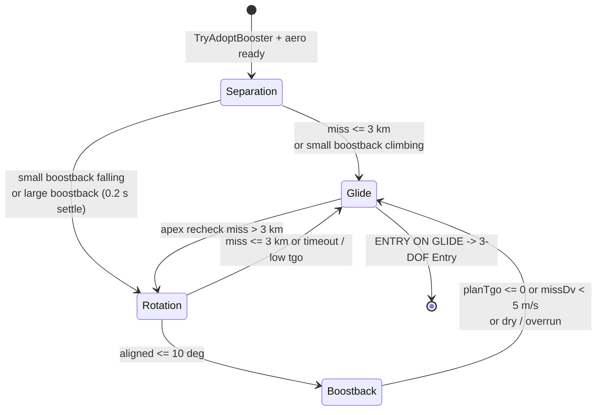

# Boostback and returnable-stage reserve

A returnable booster separates during ascent, flips back toward its landing site (or flies downrange to a drone-ship target), burns to place its atmospheric impact point on target, glides engine-off, and hands over to [Entry (3-DOF)](scvx/entry.md) and [Touchdown (6-DOF)](scvx/touchdown.md).
The mathematics of the drag-integrated impact Jacobian and finite-burn shooter are detailed in [Impact steering](reference-material/impact-steering.md); this page covers the flight state machine, the glide controller, and how convex ascent sizes the booster propellant reserve.

## Booster adoption and phase machine

### Separation adoption (`Autopilot.cs`)

1. `OnDecouplerActivating` records a `BoosterHandover` (valid for `30 s`, `HandoverWindowS`) storing the attachment root, landing site latitude/longitude, `GlideOnly` flag (for `OPTIMAL RETURN`), landing engine group, and parent stage reference.
2. `TryAdoptBooster` matches the newly split child `Vehicle`, cuts inherited throttle (`EngineOn = false`), stores `BoostbackClearOf`, and schedules `StepBoosterHandover`.
3. `StepBoosterHandover` retries `ExecuteBoostback` every `0.5 s` (`HandoverRetryS`) until the part tree settles and `KsaAeroSweep` produces a valid aero surrogate.
4. **Non-sticky error recovery:** stale `_s.AeroError` is cleared as soon as `_s.Aero?.Table != null` (strictly preserving `KsaAeroSweep.RebuildingError` while a mesh rebuild is active) so transient setup errors never latch boostback permanently disabled.

### Phase rules (`Boostback.cs`)

- **`Separation` ("SETTLE"):** Holds separation attitude (`BoostbackHoldDir`) engine-off until the gap from `BoostbackClearOf` opens by `30 m` (`BoostbackClearanceM`, or `30 s` timeout). Once `ImpactSteering` reports initial miss:
  - `missKm <= 3.0 km` (`BoostbackGlideMissKm`): skips burn -> `Glide`.
  - `missKm <= 20.0 km` (`BoostbackLargeMissKm`) or `BoostbackGlideOnly`: "small boostback" (no lit settle). Defers to apex in `Glide` if climbing, or enters `Rotation` engine-off if falling.
  - Otherwise ("large boostback"): lights at `SettleThrottle` (min throttle, fallback `5 %`) for `0.2 s` (`BoostbackSeparationS`) -> `Rotation`.
- **`Rotation` ("SLEW"):** Slews toward `BoostbackShooter`'s initial burn direction at `30 deg/s` (`BoostbackSlewDegS`), lifting the slew cap once within `135 deg` (`BoostbackFlipFreeDeg`). Large boostbacks keep `SettleThrottle` lit for gimbal authority. Transitions to `Boostback` once both command and craft errors are within `10 deg` (`BoostbackAlignDeg`), triggering an immediate plan refresh and setting a burn-duration backstop (`max(3 * planTgo, 30 s)`).
- **`Boostback` ("BURN"):** Flies full throttle along `BoostbackShooter`'s linear-tangent law $\hat{\mathbf i}_F(\tau) = \operatorname{unit}(\boldsymbol\lambda + \dot{\boldsymbol\lambda}\tau)$ on a receding horizon:
  - **Cruise cadence:** re-solves every `2.0 s` sim time (`BoostbackPlanIntervalS`), with `BoostbackShooter.Shoot` rotating cutoff-epoch CCF impact by $-\Omega_z t_{\text{burn}}$ in `Dual` arithmetic and rotating the ground target forward by $+\Omega_z t_{\text{flown}}$ into the live epoch.
  - **Terminal cadence:** inside `5.0 s` (`BoostbackTerminalS`), switches to `5 Hz` (`BoostbackTerminalIntervalS = 0.2 s`).
  - **Tail lock:** inside `1.0 s` (`BoostbackLockTgo`), stops re-solving and flies the standing linear-tangent law to cutoff on the plan's clock.
  - Cuts off to `Glide` when `planTgo <= 0`, `!BoostbackLocked && missDv < 5 m/s` (`BoostbackCutoffDvMs`), tanks run dry, or the backstop expires.
- **`Glide` ("GLIDE"):** Engine off. While climbing after a small/skipped burn (`BoostbackClimbHold`), holds nose-first along airflow until apex, then runs a single apex recheck (restarting a boostback burn if `apexKm > 3.0 km`).
  - **Vacuum & dynamic-pressure continuity:** above the atmosphere (`q < 10 Pa`), holds planned orientation and updates `ImpactPredictor` / `_s.GlideTgo` *before* returning so `ThreeDofEngageTgoS` never freezes on `NaN`.
  - **`ENTRY ON GLIDE` hand-over:** when `ThreeDofFromGlide` is enabled (default), engages [Entry (3-DOF)](scvx/entry.md) in standby pre-planning at `0.5 kPa` (`ThreeDofStandbyQkPa`) with active take-over at `1.0 kPa` (`ThreeDofEngageQkPa`), backed by a time-to-go backstop at `GlideTgo <= 45 s` (`ThreeDofEngageTgoS`).

## Aerodynamic glide steering (`BoostbackGlide.cs`)

Between boostback cutoff and 3-DOF entry take-over, `BoostbackGlide` runs at `10 Hz` (`GlideIntervalMs = 100 ms`):

- Computes `ImpactPredictor.VelocityJacobian` with nominal AoA `2.5 deg` (`GlideNominalAoaDeg`, max `7.5 deg`) and updates `GlideTgo = max(nom.TimeOfFlight.V, 5.0 s)`.
- When `GlideSteerMiss` is enabled and aerodynamic authority exceeds `0.05 m/s^2` (`GlideMinAuthority`, with $L/D \ge 0.02$), a ZEM/PID controller (`GlideKp = 15.0`) requests impact velocity $-\mathbf u_{\text{pid}} / t_{\text{go}}$, mapped via damped $2\times 2$ least squares (`GlideSolveDamping = 1e-3`) to body lift accelerations and inverted to body tilt via 2x2 Newton on `BodyAeroTable` (`GlideTiltOnBodyTable`, 12 iters max) or roll-averaged `GlideAoaForLift`.
- Attitude control runs through AFC's own [AttitudeController](attitude/index.md) (`BoostbackGlideOwnAttitude = true`, fins + RCS).

## Returnable-stage reserve sizing (`AscentRecovery` & `BoostbackOracle`)

Convex ascent sizes each returning booster's propellant reserve inside the ascent optimization itself rather than guessing a fixed fraction:

### Rocket-equation reserve model

For a required boostback impulse $\Delta v_{\text{bb}}$, `AscentRecovery.RequiredKg` computes:

$$
m_{\text{res}}(\Delta v_{\text{bb}}) = m_{\text{dry,booster}}\!\left[\exp\!\left(\frac{1.25\,\Delta v_{\text{bb}} + 100\ \text{m/s}}{v_{e,\text{bb}}} + \frac{\Delta v_{\text{land}}}{v_{e,\text{land}}}\right) - 1\right],
$$

where $\Delta v_{\text{land}}$ is derived from sea-level terminal velocity $v_{\text{term}} = \sqrt{2 m_{\text{dry}} g / (\rho_0 C_D(0.3, 0) A)}$ as $1.1\,v_{\text{term}}\,a / (a - g)$ with $a = \max(a_{\text{land}}, 1.2 g)$ (or $1.3\,v_{\text{term}}$ if landing acceleration is unknown).
For `OPTIMAL RETURN` (downrange drone ship), $\Delta v_{\text{bb}} = 0$ and only landing plus `100 m/s` correction reserve is kept.

### SCvx coupling (`AscentCase`, `AscentSubproblem`)

- `BoostbackOracle.Boostback` propagates the separation state through `BurnDelayS = 15.0 s`, solves minimum-norm impulse via damped Gauss-Newton (`MissToleranceM = 1.0 m`, 40 iters), and applies up to `6` null-space projections (`NullToleranceMs = 0.5 m/s`) for the unique smallest $\Delta v_{\text{bb}}$.
- `BoostbackOracle.Evaluate` computes finite-difference gradients $(\mathbf g_r, \mathbf g_v, g_t)$ with steps `(200 m, 2 m/s, 2 s)`.
- The SCvx subproblem adds a per-stage reserve variable $\Delta R$ (trust box `0.2` canonical mass) and linearised constraint at separation node $k_s$:

    $$
    R_0 + \Delta R + s_{\text{rec}} \ge \bar m_{\text{need}} + \mathbf g_r\cdot(\mathbf r - \bar{\mathbf r}) + \mathbf g_v\cdot(\mathbf v - \bar{\mathbf v}) + g_t(t - \bar t), \qquad s_{\text{rec}} \ge 0,
    $$

    penalised by `RhoRecovery = 1e3` (far above orbital propellant weight `1`) so the ascent never buys payload mass by stranding a booster.

- For side boosters (`FlowShare < 1`), reserving $R$ ends the stage $R / \chi$ early and carries the core's unburned share $R(1/\chi - 1)$ into the next stage.

### Two-lever flight execution and `OPTIMAL RETURN`

1. **UPFG planning (`ApplyAscentReserve`):** raises stage 0's dry mass by `ReserveKg / FlowShare` so UPFG pitches for early separation.
2. **Staging cues (`ShouldStageForReserve` / `ShouldStageForDroneShip`):** stages as soon as remaining booster propellant reaches `ReserveKg`. For `OPTIMAL RETURN`, `BoosterReturn.Compute` freezes the converged separation impact point as the drone-ship target at lift-off; during climb, `ShouldStageForDroneShip` predicts live booster impact at `10 Hz` using the booster's swept aero (`KsaAeroSweep.TryStartBooster`) and stages when impact reaches the drone ship (or at `ReserveKg`, whichever comes first).

## Code map

| File | Main type or method | Role |
| --- | --- | --- |
| [Boostback.cs](../../AdvancedFlightComputer/Features/Guidance/Modes/Boostback.cs) | `StepBoostback`, `UpdateBoostbackPlan` | 4-phase state machine, 2 s -> 5 Hz -> 1 s lock, 3-DOF hand-over |
| [BoostbackGlide.cs](../../AdvancedFlightComputer/Features/Guidance/Modes/BoostbackGlide.cs) | `GlideDirection`, `UpdateGlidePid`, `GlideTiltOnBodyTable` | 10 Hz aerodynamic glide guidance and lift inversion |
| [DroneShipSeparation.cs](../../AdvancedFlightComputer/Features/Guidance/Modes/DroneShipSeparation.cs) | `ShouldStageForDroneShip` | 10 Hz live impact cue for `OPTIMAL RETURN` boosters |
| [PoweredBurn.cs](../../AdvancedFlightComputer/Features/Guidance/Numerics/Flight/PoweredBurn.cs) | `BoostbackShooter.Solve`, `Shoot`, `PoweredBurnSystem` | Finite-burn direct shooting with planetary rotation |
| [ImpactPredictor.cs](../../AdvancedFlightComputer/Features/Guidance/Numerics/Flight/ImpactPredictor.cs) | `ImpactPredictor.Predict`, `VelocityJacobian` | Dual-number RK4 drag coast and co-rotating Jacobian |
| [ImpactSteering.cs](../../AdvancedFlightComputer/Features/Guidance/Numerics/Flight/ImpactSteering.cs) | `ImpactSteering.Correction`, `FreeDirection` | Damped Gauss-Newton impulse and Jacobian null-space |
| [AscentRecovery.cs](../../AdvancedFlightComputer/Features/Guidance/Scvx/Ascent/AscentRecovery.cs) | `AscentRecovery.RequiredKg`, `BoostbackOracle.Evaluate` | Rocket-equation reserve model and finite-difference gradients |
| [BoosterReturn.cs](../../AdvancedFlightComputer/Features/Guidance/Scvx/Ascent/BoosterReturn.cs) | `BoosterReturn.Compute` | Ground-fixed return tracks and `OptimalReturn` site placement |
