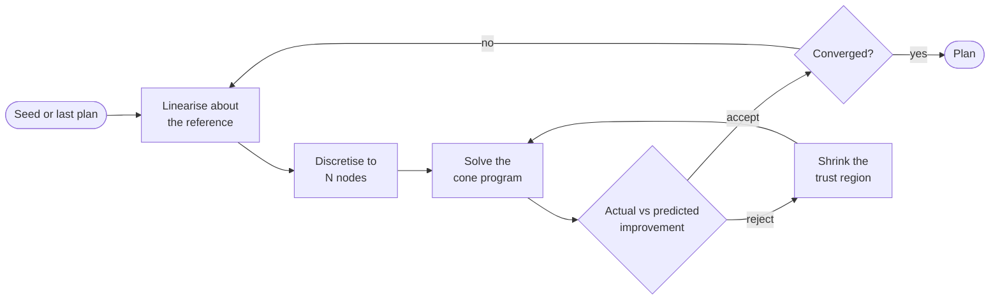

# Successive convexification

Three of AFC's planners use the same algorithm on three different problems:

| Planner | Plans | Page |
| --- | --- | --- |
| Convex ascent | the climb from the pad to the hand-over to UPFG | [Convex ascent](ascent.md) |
| Entry guidance (3-DOF) | the unpowered glide through the air, then the landing burn | [Entry (3-DOF)](entry.md) |
| Touchdown guidance (6-DOF) | the end of the landing burn down to the ground, with attitude | [Touchdown (6-DOF)](touchdown.md) |

The algorithm is **successive convexification**, or SCvx. This page describes the parts the three planners share. Each problem page then states its own problem in continuous form, and says how each of its constraints is made convex. G-FOLD is not on this list: it makes its problem convex once, exactly, and solves a single cone program. See [G-FOLD](../gfold.md).

## The template problem

Every planner solves a free-final-time optimal control problem of this shape:

$$
\begin{aligned}
\min_{\mathbf u(\cdot),\,\mathbf p}\quad & \phi\big(\mathbf x(t_f),\mathbf p\big) + \int_0^{t_f} \ell\big(\mathbf x(t),\mathbf u(t)\big)\,dt \\
\text{s.t.}\quad & \dot{\mathbf x} = \mathbf f(\mathbf x,\mathbf u,\mathbf p) && \text{dynamics} \\
& \mathbf x(0) = \mathbf x_0 && \text{the craft now} \\
& \mathbf g_f\big(\mathbf x(t_f)\big) = \mathbf 0 && \text{terminal conditions} \\
& \mathbf c(\mathbf x,\mathbf u) \in \mathcal K && \text{convex path constraints} \\
& \mathbf s(\mathbf x,\mathbf u,\mathbf p) \le \mathbf 0 && \text{non-convex path constraints}
\end{aligned}
$$

- $\mathbf x$ is the state, such as position, velocity, mass and, for touchdown, attitude and body rates.
- $\mathbf u$ is the control, such as thrust, attitude, gimbal angles, fin deflections or RCS torque.
- $\mathbf p$ holds the free parameters: the final time or the phase durations.
- $\mathcal K$ is a product of convex cones: boxes, half-spaces and second-order cones.

Three things stop a convex solver from taking this problem directly. The dynamics $\mathbf f$ are non-linear. Some constraints $\mathbf s$ are not convex. And the final time multiplies the dynamics. SCvx deals with all three the same way. It takes a reference trajectory, replaces everything non-convex by its linearisation about that reference, solves the resulting convex problem, and repeats from the answer. Two safeguards keep this from running away: a [trust region](#trust-region) stops the step from leaving the region where the linearisation is good, and a [virtual control](#virtual-control) keeps every subproblem feasible.

## Free final time and phases

A free final time does not fit a fixed grid of nodes. The usual fix is time dilation. Each phase $i$ runs on its own normalised time $\tau \in [0,1]$ with a duration $\sigma_i$, so $t = \sigma_i \tau$ inside the phase and

$$
\frac{d\mathbf x}{d\tau} = \sigma_i\,\mathbf f(\mathbf x,\mathbf u).
$$

The node grid stays fixed in $\tau$ while the durations $\sigma_i$ become ordinary decision variables. A phase boundary placed this way turns a discrete event into a continuous one. For example, the ignition time of entry guidance is the duration of its glide phase, so deciding when to light the engine needs no integers. The product $\sigma_i\,\mathbf f$ is bilinear and is [linearised](#linearisation) like everything else. Each problem bounds its durations in a box.

## Linearisation

Each iteration linearises about the current reference $(\bar{\mathbf x},\bar{\mathbf u},\bar\sigma)$. With $\delta$ marking the change from the reference,

$$
\sigma\,\mathbf f(\mathbf x,\mathbf u) \approx \bar\sigma\,\bar{\mathbf f} + \bar\sigma\big(A\,\delta\mathbf x + B\,\delta\mathbf u\big) + \bar{\mathbf f}\,\delta\sigma,
\qquad
A = \frac{\partial \mathbf f}{\partial \mathbf x},\quad
B = \frac{\partial \mathbf f}{\partial \mathbf u},
$$

with $\bar{\mathbf f}$, $A$ and $B$ evaluated on the reference. A non-convex inequality $s(\mathbf x,\mathbf u) \le 0$ becomes its tangent half-space,

$$
\bar s + \nabla s(\bar{\mathbf x},\bar{\mathbf u})^\top\begin{bmatrix}\delta\mathbf x\\ \delta\mathbf u\end{bmatrix} \le 0 .
$$

A constraint that keeps a variable on a curved set, such as a unit vector $\lVert\mathbf b\rVert = 1$ or a unit quaternion, becomes the tangent plane at the reference, $\bar{\mathbf b}^\top\mathbf b = 1$. The reference is projected back onto the set after every step. Without that projection the reference drifts off the set, and the tangent plane stops agreeing with a small trust region.

Each linearisation is exact at the reference and wrong away from it. The trust region decides how far away is still acceptable.

All three planners get $A$ and $B$ by **forward-mode automatic differentiation**: the dynamics are written once in C# over dual numbers, and one sweep per input gives an exact column of the Jacobian. Nothing is differentiated by hand, and nothing by finite differences, except where a quantity comes from a table or a simulation. Touchdown's fin columns come from the fin tables, and the ascent's booster-return reserve from a flown booster.

## Discretisation

The trajectory becomes $N$ nodes $k = 0,\dots,N-1$, evenly spaced in $\tau$ within each phase. All three planners use **trapezoidal collocation**: each interval is closed by the average of the linearised dynamics at its two ends,

$$
\mathbf x_{k+1} = \mathbf x_k + \frac{\Delta\tau}{2}\big(\mathbf g_k + \mathbf g_{k+1}\big) + \boldsymbol\nu_k,
\qquad
\mathbf g_k = \bar\sigma\,\bar{\mathbf f}_k + \bar\sigma\big(A_k\,\delta\mathbf x_k + B_k\,\delta\mathbf u_k\big) + \bar{\mathbf f}_k\,\delta\sigma .
$$

This is one linear equality per interval. The controls enter at both ends of the interval, so they behave like a first-order hold, ramping from $\mathbf u_k$ to $\mathbf u_{k+1}$. There are no sub-steps. $\boldsymbol\nu_k$ is the [virtual control](#virtual-control). The merit uses the same trapezoid, with the true $\mathbf f$ in place of its linearisation. At a phase boundary, such as ignition or staging, the node is linearised once for each phase, or two nodes share the instant and an exact row joins them.

Path constraints are imposed at the nodes only. Between nodes the plan can break them slightly, so a few more nodes buy a closer match at the cost of a larger cone program.

## Virtual control

A linearised subproblem can be infeasible even when the real problem is not. For example, a small trust region may not reach the terminal conditions. The virtual control $\boldsymbol\nu_k$ is a free slack on every dynamics row that makes the subproblem always feasible. All three planners price it with a squared, scaled two-norm and a large weight $\rho_{vc}$ ($10^5$ in each):

$$
J_{\text{sub}} = J + \rho_{vc} \sum_k \big\lVert \boldsymbol\nu_k \oslash \mathbf x_{\text{scale}} \big\rVert_2^2 .
$$

The textbook choice is a one-norm, which is an *exact* penalty: with a large enough weight the optimum has $\boldsymbol\nu = \mathbf 0$ exactly. A squared price is smoother for the cone solver but only drives $\boldsymbol\nu$ close to zero. AFC therefore does not trust $\boldsymbol\nu$ to judge a plan. It tests the true defect of the plan instead. See [Convergence](#convergence).

A virtual control that will not shrink is a diagnosis in itself. It means the requested manoeuvre cannot be flown under the constraints, and the planner refuses rather than fakes it. Touchdown stages its price: the velocity scale inside the norm tightens over the first accepted steps, so a cold solve can first find the shape of the plan and then the detail.

## Trust region

The trust region bounds how far one step may move from the reference:

$$
\big\lVert\,\big(\delta\mathbf x_k,\ \delta\mathbf u_k,\ \delta\sigma\big) \oslash \text{scale}\,\big\rVert \le \eta .
$$

The changes are divided by their scales so that one radius $\eta$ means the same for every variable. All three planners use a **hard infinity-norm** bound: a box made of plain linear rows on every node's state, every control and every free duration. A two-norm ball would be a second-order cone per node, which costs more and gains little here. Touchdown also adds a small **proximal term**, a penalty $w_{\text{prox}}\lVert\delta\rVert^2$, which keeps a re-solve close to the plan already flying even inside the box.

After each step the radius is updated from how well the subproblem predicted the real improvement. See [Accepting a step](#accepting-a-step), and the [merit slice](../scvx-bridge-devnotes.md#see-it-work) to watch it happen.

## Soft constraints and slacks

Node 0 is the craft as it is now. Its state is fixed, so a path constraint that the craft already breaks at node 0 would make every subproblem infeasible. Entry and touchdown therefore impose their path constraints from node 1 on. They also give the ones that may be out of reach a non-negative slack $s_k$ with a linear price:

$$
c(\mathbf x_k,\mathbf u_k) \le s_k,\qquad s_k \ge 0,\qquad J_{\text{sub}} \mathrel{+}= w_s \sum_k s_k .
$$

The plan then bends back inside the limit as fast as it can, instead of failing. A linear price on a non-negative slack is a one-norm, so it drives the slack to exactly zero once the limit can be met. The ascent needs no node-1 rule: its path limits apply only where the dynamic pressure is above 100 Pa, which the pad never is.

The same trick softens **terminal conditions**. Entry and touchdown price the miss of the target position and velocity with linear slacks, and the ascent prices its orbit-insertion miss with squared slacks. A plan that cannot quite reach the target then lands as close as it can, and the miss shows up in the merit.

## Accepting a step

A step is judged on the real, non-linear problem. The **merit** is the subproblem's objective term for term, with each linearised quantity replaced by its true value: the true defect $\mathbf d_k$ of each interval (the trapezoid with the true $\mathbf f$) in place of $\boldsymbol\nu_k$, the true terminal miss, and the true violation of each path limit:

$$
\Phi(\mathbf x,\mathbf u,\sigma) = J + \rho_{vc} \sum_k \big\lVert \mathbf d_k \oslash \mathbf x_{\text{scale}} \big\rVert_2^2 + \text{terminal miss} + w_s \sum_k \max\big(0,\ c(\mathbf x_k,\mathbf u_k)\big) .
$$

The subproblem predicts its own value of $\Phi$. The ratio of actual to predicted improvement decides the step:

$$
\rho = \frac{\Phi(\bar{\cdot}) - \Phi(\cdot^\star)}{\Phi(\bar{\cdot}) - \Phi_{\text{lin}}(\cdot^\star)} .
$$

All three planners use the same rule:

| $\rho$ | Meaning | Action |
| --- | --- | --- |
| $\rho \le 0$ | the step made things worse | reject it, shrink $\eta \leftarrow \eta/2$ |
| $0 < \rho < 0.25$ | it helped, much less than predicted | accept it, shrink $\eta \leftarrow \eta/2$ |
| $0.25 \le \rho < 0.7$ | it helped about as predicted | accept it, keep $\eta$ |
| $\rho \ge 0.7$ | the prediction was good | accept it; grow $\eta \leftarrow 1.5\,\eta$ only if the step used at least 80 % of the radius |

The 80 % rule stops the radius from growing when the step was not limited by it, for example near a flat optimum. The radius is clamped between a minimum and a maximum. A cone solve that fails, or stops at its iteration cap, counts as a rejected step: the radius shrinks and the same reference is tried again. The limits of each planner are in the table [below](#the-three-problems-compared).

## Convergence

Entry and touchdown call a plan converged when an accepted step barely moves the trajectory and the true defects are small:

$$
\max_k \big\lVert(\mathbf x^\star_k - \bar{\mathbf x}_k) \oslash \mathbf x_{\text{scale}}\big\rVert_\infty < \epsilon_{\text{step}},
\qquad
\max_k \big\lVert \mathbf d_k \oslash \mathbf x_{\text{scale}} \big\rVert_\infty < \epsilon_{\text{defect}} .
$$

The first test says the iterate has stopped moving. The second says the plan obeys the real dynamics, not only their linearisation. The ascent stops instead when the predicted improvement is tiny and the reference passes a list of gates: defect, path violation, insertion miss and booster reserve.

In flight a planner rarely runs to convergence. Entry and touchdown re-solve within a time budget and fly the best plan so far, so each checks a candidate against a **plan gate** before flying it: its defect in physical units (metres, metres per second, kilograms), strict at the start of the plan and looser towards its end. A plan that fails the gate is refused, and the craft keeps flying the previous one.

## Scaling

The variables live on very different scales. A position may be thousands of metres, a mass tens of tonnes, a torque a few hundred newton-metres, and a quaternion component less than one. Every planner divides each variable by a typical size before it builds the cone program. This matters twice:

- **The trust region.** One radius $\eta$ applies to every scaled variable. A badly scaled variable either never moves, or makes the trust region bind on it alone. Touchdown guidance hit the second case with RCS torque, whose scale was its own small authority: the trust region bound on RCS and the solver needed ten times the iterations. Scaling RCS by the whole torque authority of the craft fixed it.
- **The cone solver.** First-order solvers such as SCS converge slowly on badly conditioned problems. The rows are equilibrated as well as the columns.

## The cone program

After linearisation and discretisation, every subproblem is a **second-order cone program**: a linear objective, linear equalities, linear inequalities and second-order cones,

$$
\min_{\mathbf y}\ \mathbf c^\top\mathbf y
\quad\text{s.t.}\quad
G\mathbf y + \mathbf s = \mathbf h,\quad \mathbf s \in \{0\}^{m_0}\times\mathbb R_+^{m_1}\times\mathcal Q^{n_1}\times\dots\times\mathcal Q^{n_j},
$$

where $\mathcal Q^n = \{(t,\mathbf w) : \lVert\mathbf w\rVert_2 \le t\}$. Strictly it is a quadratic cone program: the squared penalties (virtual control, smoothing, proximal term) go straight into a quadratic objective $\tfrac12\mathbf y^\top P\mathbf y + \mathbf c^\top\mathbf y$, which both solvers accept, rather than through extra cones. AFC ships two native solvers:

- **SCS**, a first-order (ADMM) solver, used by entry and touchdown. Each iteration is cheap and it warm-starts well from the previous plan, which suits re-solving in flight. It reaches moderate accuracy, and its run time depends strongly on scaling and tolerance.
- **Clarabel**, an interior-point solver, used by the ascent and by G-FOLD. It reaches high accuracy in a few dozen iterations whatever the starting point, but cannot be warm-started. The ascent plans once on the pad, where accuracy matters more than speed.

[Native solvers](../native-build.md) covers how both are built and shipped.

## Re-solving in flight

Entry and touchdown guidance do not plan once. They re-solve while they fly, as a receding-horizon controller (model predictive control, MPC):

1. Every 0.1 s, node 0 is set to the measured state of the craft.
2. The last plan, resampled onto the new grid and shifted forward in time, is the seed. A warm start needs only a few SCvx iterations, and SCS is warm-started too.
3. The solve runs on a worker thread, within a wall-clock budget of tens of milliseconds.
4. The new plan passes the [plan gate](#convergence) before it replaces the old one. A refused re-solve leaves the craft flying the previous plan, and the next cycle tries again with a wider trust region.

The convex ascent plans once on the pad, on a background thread, with a set of retries when a solve is not usable (more stages, a higher dynamic-pressure limit, a held throttle). UPFG then flies the closed loop after the hand-over.

## Common convexification moves

The same few moves make the constraints of all three problems convex. Each problem page names the move it uses for each constraint.

| Move | What it does | Used for |
| --- | --- | --- |
| **Keep it as it is** | Boxes, linear rows and norms bounded by a linear expression are already convex. | throttle boxes, gimbal ranges, tilt cones on a control vector |
| **Linearise about the reference** | Replace a non-convex function by its tangent; the trust region keeps it honest. | dynamics, dynamic pressure, minimum altitude, aero forces |
| **Tangent plane plus projection** | Keep a unit vector or quaternion on its sphere. | entry's attitude vector, touchdown's quaternion |
| **Split magnitude from direction** | A scalar magnitude times a unit direction turns a hollow set like $\{0\}\cup[T_{\min},T_{\max}]$ into a box. | entry's thrust floor |
| **Lossless convexification** | Relax a non-convex bound with a slack that is provably tight at the optimum. | G-FOLD's thrust bounds |
| **Rate rows between nodes** | Limit the change of a control from one node to the next with linear rows. | gimbal and fin slew, throttle rate |
| **Soft with a slack** | Price a violation instead of forbidding it, from node 1 on. | path limits the craft may already break |

## The three problems compared

| | [Convex ascent](ascent.md) | [Entry (3-DOF)](entry.md) | [Touchdown (6-DOF)](touchdown.md) |
| --- | --- | --- | --- |
| State | position, velocity, mass | position, velocity, mass | position, velocity, mass, quaternion, body rate |
| Phases | one per stage, joined at staging | glide, burn | coast (optional), burn |
| Free durations | one per stage | glide, burn | coast, burn |
| Nodes | 60 per stage | 12 glide + 17 burn | 50 down to 5, by a spacing target |
| Virtual control | squared, $\rho_{vc} = 10^5$ | squared, $\rho_{vc} = 10^5$ | squared, $\rho_{vc} = 10^5$, staged |
| Trust region | box, $\eta \in [5\times10^{-4},\,0.3]$ | box, $\eta \in [10^{-3},\,0.1]$ | box, $\eta \in [10^{-3},\,0.1]$, plus proximal term |
| Stops when | predicted gain $< 10^{-5}$ and all gates met | step $< 8\times10^{-3}$, defect $< 10^{-3}$ | step $< 8\times10^{-3}$, defect $< 10^{-3}$ |
| Cone solver | Clarabel, tolerance $10^{-8}$ | SCS, $10^{-4}$, warm | SCS, $10^{-4}$ ($10^{-3}$ with RCS), warm |
| Runs | once on the pad, with retries | every 0.1 s in flight | every 0.1 s in flight |

The problem pages give the detail behind each cell, with the config names.
