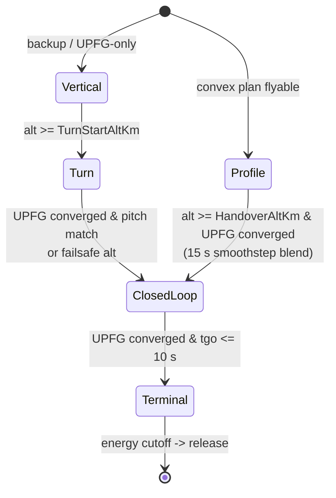

# UPFG and ascent hand-over

Unified Powered Flight Guidance (UPFG) is AFC's closed-loop orbital ascent controller.
On the pad, [convex ascent](scvx/ascent.md) solves the full atmospheric trajectory once; once the craft reaches high altitude, control hands over to UPFG, which steers closed-loop to orbit insertion and cuts the engine on target orbital energy.
When convex ascent is disabled or unavailable, UPFG flies the entire closed-loop climb after an open-loop pitch-over turn.

## Ascent phase machine

Overlaying the early climb on any phase, `IsPadAscent` (air speed `< 30 m/s`) enforces two pad guards:

- **Pad hold (`PadHold`):** commands straight up with decoupled roll until `r - LiftoffRadius >= 50 m` (`PadClearM`).
- **Roll program (`RollProgramHolds`):** when `ForceRoll` is set, holds vertical until `RollErrorDeg <= 3 deg` (`RollProgramDoneDeg`) or `10 s` (`RollProgramMaxS`) have elapsed.

### Convex-ascent hand-over

`Profile` flies the open-loop SCvx plan and hands over to `ClosedLoop` when `ConvexProfileDone` trips:

- `ConvexPlanTime >= profile.EndTime`, or
- `alt >= HandoverAltKm` and `Upfg.Converged` (and not finishing a solid-only launch), where `HandoverAltKm = AscentHandover.AltitudeKm(80 km, Pe, Ap)` caps hand-over at 75 % of the target periapsis.

On hand-over, `ClosedLoop` blends the steering direction from the convex profile to UPFG over `ConvexBlendSeconds = 15.0 s` using a smoothstep $x^2(3 - 2x)$.
Between guidance updates, commanded direction is slew-limited at `MaxSlewDegS = 5.0 deg/s`, publishing the matching turning rate via `KsaAttitudeRate.Set`.

## Vehicle stage model (`KsaVehicleAdapter`)

Every `250 ms` (`StageModelIntervalMs`), `KsaVehicleAdapter` rebuilds `UpfgVehicle` from KSA's sequence drain simulation (`vehicle.Parts.PerformanceSequences`):

1. **Duplicate repair (`CorrectDuplicateRegistration`):** corrects parts registered in multiple sequences.
2. **Phase coalescing (`Coalesce`):** merges adjacent constant-thrust intervals with matching thrust/$I_{sp}$ (within $10^{-3}$ relative), matching drain throttle, and continuous mass ($\lvert m_{\text{dry},a} - m_{\text{tot},b}\rvert \le 10^{-4}\max(m_{\text{tot},a}, 1)$); drops dust phases shorter than `1e-3 s` or below `1.0 m/s` delta-v.
3. **Ambient-pressure scaling (`ApplyAmbientPressure`):** scales stage 0's `Thrust` and `Isp` by `PhaseThrustAtPressure(ambient) / PhaseThrustAtPressure(modelPressure)` while keeping mass flow invariant to back pressure.
4. **G-limit splitting (`ApplyGLimit`):** takes `EffectiveAccelLimitG = min(UserGLimitG, StructuralAccelerationLimit / g0)` and splits any stage that crosses $a_{\lim}$ mid-burn at $m_{\lim} = T / a_{\lim}$ into a constant-thrust segment (Mode 1) followed by a constant-acceleration segment (Mode 2).
5. **Booster reserve (`ApplyAscentReserve`):** raises stage 0's `MassDry` by `ReserveKg / FlowShare` (and carries the core's unburned share into stage 1 when `FlowShare < 1`) so UPFG plans around early booster separation.

## The UPFG recursion (`UpfgGuidance`)

`UpfgGuidance` is a double-precision CCI solver (`Brutal.Numerics.double3`) stepped at `1 Hz` (`GuidanceCycle = 1.0 s`).
It supports Mode 1 (orbital ascent), Mode 2 (predictive braking), and Mode 3 (precision landing).
In orbital ascent, each cycle runs eight steps:

### 1. Stage parameters and sensed velocity

For each stage $i$, $v_{e,i} = I_{sp,i} g_0$, $\dot m_i = T_i / v_{e,i}$, $a_{\lim,i} = G_{\lim,i} g_0$, $a_{T,i} = T_i / m_{0,i}$, and $\tau_i = v_{e,i} / a_{T,i}$.
Stage 0 refreshes $a_T$, $\tau$, and remaining burn time from live vehicle mass; if Mode 2, throttle commands $\max(a_{\lim} / (T / m), 0.05)$.

Non-gravitational sensed velocity subtracts trapezoidal gravity before updating velocity-to-go:

$$
\Delta\mathbf v_{\text{sensed}} = (\mathbf v - \mathbf v_{\text{prev}}) - \tfrac12(\mathbf g_{\text{prev}} + \mathbf g_{\text{curr}})\,\Delta t,
\qquad
\mathbf v_{\text{go}} \leftarrow \mathbf v_{\text{go}} - \Delta\mathbf v_{\text{sensed}}.
$$

### 2. Burn times (`ComputeBurnTimes`)

Each non-final stage contributes ideal delta-v $L_i = v_{e,i}\ln(\tau_i / \max(\tau_i - t_{b,i}, 10^{-6}))$ (Mode 1) or $L_i = a_{\lim,i} t_{b,i}$ (Mode 2).
The final stage takes the remainder $L_{n-1} = \lVert\mathbf v_{\text{go}}\rVert - \sum_{i < n-1} L_i$; if earlier stages already exceed $\lVert\mathbf v_{\text{go}}\rVert$, the last stage is dropped and the calculation repeats.
Per-stage burn times $t_{b,i} = \tau_i(1 - e^{-L_i / v_{e,i}})$ (Mode 1) or $L_i / a_{\lim,i}$ (Mode 2) sum to total time-to-go $t_{\text{go}}$.

### 3. Thrust integrals (`ComputeThrustIntegrals`)

For each stage $i$, closed-form thrust integrals $(L_i, J_i, S_i, Q_i, P_i)$ capture velocity, time-weighted velocity, position, and quadratic turning moments:

- **Mode 1 (constant thrust):**

    $$
    J_i = \tau_i L_i - v_{e,i} t_{b,i}, \qquad
    S_i = -J_i + L_i t_{b,i}, \qquad
    Q_i = S_i(\tau_i + t_{\text{go},i-1}) - \tfrac12 v_{e,i} t_{b,i}^2,
    $$

    $$
    P_i = Q_i(\tau_i + t_{\text{go},i-1}) - \tfrac12 v_{e,i} t_{b,i}^2\big(\tfrac13 t_{b,i} + t_{\text{go},i-1}\big).
    $$

- **Mode 2 (constant acceleration):**

    $$
    J_i = S_i = \tfrac12 L_i t_{b,i}, \qquad
    Q_i = S_i\big(\tfrac13 t_{b,i} + t_{\text{go},i-1}\big),
    $$

    $$
    P_i = \tfrac16 S_i\big(t_{\text{go},i}^2 + 2 t_{\text{go},i} t_{\text{go},i-1} + 3 t_{\text{go},i-1}^2\big).
    $$

Cross-stage terms accumulate into total $L, J, S, Q, P$ and $H = J t_{\text{go}} - Q$.

### 4. Guidance vectors and singularity guards (`ComputeGuidanceVectors`)

With unit velocity-to-go $\hat{\boldsymbol\lambda} = \mathbf v_{\text{go}} / \lVert\mathbf v_{\text{go}}\rVert$, scaled gravity displacement $\mathbf r_{\text{grav}} \leftarrow \mathbf r_{\text{grav}}(t_{\text{go}} / t_{\text{go,prev}})^2$, and range-to-go $\mathbf r_{\text{go}} = \mathbf r_d - (\mathbf r + \mathbf v t_{\text{go}} + \mathbf r_{\text{grav}})$ in target basis $(\hat{\mathbf i}_x, \hat{\mathbf i}_y = -\hat{\mathbf n}, \hat{\mathbf i}_z = \operatorname{unit}(\mathbf r_d \times \hat{\mathbf i}_y))$:

$$
r_{\text{go},z} = \begin{cases}
\dfrac{S - \hat{\boldsymbol\lambda}\cdot\mathbf r_{\text{go},xy}}{\hat{\boldsymbol\lambda}\cdot\hat{\mathbf i}_z}, & \lvert\hat{\boldsymbol\lambda}\cdot\hat{\mathbf i}_z\rvert \ge 0.15 \\[6pt]
\operatorname{clamp}(\hat{\mathbf i}_z\cdot\mathbf r_{\text{go}},\ -\lvert S\rvert,\ \lvert S\rvert), & \lvert\hat{\boldsymbol\lambda}\cdot\hat{\mathbf i}_z\rvert < 0.15
\end{cases}
$$

When $\lvert\hat{\boldsymbol\lambda}\cdot\hat{\mathbf i}_z\rvert < 0.15$, `Converged` is cleared to `false` rather than dividing by a near-zero projection.
Turning rate $\dot{\boldsymbol\lambda} = (\mathbf r_{\text{go}} - S\hat{\boldsymbol\lambda}) / (Q - SJ/L)$ (guarded by $\lvert Q - SJ/L\rvert > 10^{-6}$) gives the linear-tangent thrust direction $\hat{\mathbf i}_F = \operatorname{unit}(\hat{\boldsymbol\lambda} - \dot{\boldsymbol\lambda}(J/L))$.
Second-order thrust-loss terms ($\phi = \arccos(\hat{\mathbf i}_F\cdot\hat{\boldsymbol\lambda})$, $\dot\phi = -\phi L / J$ guarded by $\lvert J\rvert > 10^{-9}$, turning term guarded by $\lVert\dot{\boldsymbol\lambda}\rVert > 10^{-12}$) update $\mathbf v_{\text{bias}} = \mathbf v_{\text{go}} - \mathbf v_{\text{thrust}}$ and $\mathbf r_{\text{bias}} = \mathbf r_{\text{go}} - \mathbf r_{\text{thrust}}$.

### 5. Gravity prediction (`CseRoutine`) and target update

Conic State Extrapolation (`CseRoutine.Run`, Shepperd's universal-variable method) propagates the equivalent coast state $(\mathbf r_{c1}, \mathbf v_{c1})$ over $t_{\text{go}}$ to recover $(\mathbf r_{\text{grav}}, \mathbf v_{\text{grav}})$ and predicted cutoff position $\mathbf r_p$.
Projecting $\mathbf r_p$ into the target orbital plane yields updated $(\mathbf r_d, \mathbf v_d)$ and $\mathbf v_{\text{go}} = \mathbf v_d - \mathbf v - \mathbf v_{\text{grav}} + \mathbf v_{\text{bias}}$.
Convergence latches when the rate-independent time-to-go residual $\lvert(t_{\text{go}} - (t_{\text{go,prev}} - \Delta t)) / t_{\text{go,prev}}\rvert < 0.01$, and clears on any singularity, non-finite value, or divergence.

Between 1 Hz solves, continuous steering evaluates at elapsed $\tau \in [0, 1]\text{ s}$:

$$
\mathbf u(\tau) = \hat{\boldsymbol\lambda} + \dot{\boldsymbol\lambda}\Big(\tau - \frac{J}{L}\Big), \qquad
\hat{\mathbf i}_F(\tau) = \frac{\mathbf u(\tau)}{\lVert\mathbf u(\tau)\rVert}, \qquad
\boldsymbol\omega_{\text{cmd}}(\tau) = \frac{\hat{\mathbf i}_F(\tau) \times \dot{\boldsymbol\lambda}}{\lVert\mathbf u(\tau)\rVert}.
$$

## Free-insertion search (`UpfgInsertionSearch`)

For elliptical targets without a fixed argument of periapsis ($e \ge 10^{-3}$), `UpfgInsertionSearch` runs every `10 s` sim time (`1000 ms` wall clock) during `ClosedLoop` to find the insertion true anomaly $\nu$ that minimizes $t_{\text{go}}$:

- Scans a coarse grid (`5 deg` steps) around periapsis (`0..45 deg`, respecting the atmosphere floor) or apoapsis (`-45..-5 deg`), followed by a `2.5 deg` fine grid and parabolic vertex fit.
- Each probe runs a fresh `UpfgGuidance` instance until $t_{\text{go}}$ stays within `0.01 s` (`SettleTgoS`) over a running window of 50 consecutive solves (`SettleWindowSolves`), capped at `1500` solves per probe (`MaxProbeSolves`) and `12000` per search (`MaxSearchSolves`), the last probe held to what is left. A circular target skips the search. `Converged` also clears on a non-finite or non-positive $t_{\text{go}}$, a turning angle over 70 deg, a non-positive thrust-velocity projection, or a runaway $t_{\text{go}}$ (growing by more than 5 s and 25 %).
- Moves the target $\nu$ only if the saving is at least `0.2 s`, slews at `0.5 deg/s`, and freezes once $t_{\text{go}} < 60\text{ s}$ or $\lVert\mathbf v_{\text{go}}\rVert < 0.5\,\lVert\mathbf v_{\text{go,0}}\rVert$.

## Terminal cutoff and escape protection

When `Upfg.Converged` and `Upfg.Tgo <= 10 s`, ascent enters `Terminal`, clones `Upfg` into `TerminalLaw`, and latches `CutoffTime = LastSolveTime + Upfg.Tgo`:

- **Orbital escape cutoff invariant:** On any bound target ($E_{\text{target}} < 0$), `Modes/Ascent.cs` checks $E_{\text{now}} = \tfrac12\lVert\mathbf v\rVert^2 - \mu/\lVert\mathbf r\rVert$ every step and cuts immediately if $E_{\text{now}} \ge 0$ or ($E_{\text{target}} < -0.05\,\mu/r$ and $E_{\text{now}} > 0.25\,E_{\text{target}}$).
- **Proportional energy cutoff (`TerminalCutoffThrottle`):** Within the final `3.0 s`, scales final-step throttle by $f = (E_{\text{target}} - E_{\text{now}} - \Delta E_{\text{verlet}}) / \Delta E_{\text{thrust}}$ (compensating both discrete physics-step quantization and 1-step Velocity Verlet gravity lag) to hold apoapsis error below `0.1 km` across 1x, 4x and 10x warp. See [Convex ascent: Proportional energy terminal cutoff](scvx/ascent.md#proportional-energy-terminal-cutoff).
- **Staging cues (`AutoSequence`):** Arms AFC's [AutoStage](../dev/autostage.md) once per flight and requests staging on cold ignition, burnout, booster-reserve boundary (`ShouldStageForReserve`), or drone-ship impact cue (`ShouldStageForDroneShip`).

## Code map

| File | Main type or method | Role |
| --- | --- | --- |
| [UpfgGuidance.cs](../../AdvancedFlightComputer/Features/Guidance/Upfg/UpfgGuidance.cs) | `UpfgGuidance.Step`, `SteeringAt` | Double-precision CCI UPFG recursion and continuous steering |
| [UpfgVehicle.cs](../../AdvancedFlightComputer/Features/Guidance/Upfg/UpfgVehicle.cs) | `UpfgVehicle`, `UpfgStage` | Constant-thrust / constant-acceleration stage list |
| [KsaVehicleAdapter.cs](../../AdvancedFlightComputer/Features/Guidance/Upfg/KsaVehicleAdapter.cs) | `KsaVehicleAdapter.Build`, `ApplyAmbientPressure` | Drain-sim stage extraction, coalescing, pressure scaling |
| [UpfgTarget.cs](../../AdvancedFlightComputer/Features/Guidance/Upfg/UpfgTarget.cs) | `UpfgTarget.InsertionToward`, `HeldInsertion` | Target plane, atmosphere floor, fixed/free ArgPe |
| [CseRoutine.cs](../../AdvancedFlightComputer/Features/Guidance/Upfg/CseRoutine.cs) | `CseRoutine.Run` | Shepperd's universal-variable Conic State Extrapolation |
| [UpfgInsertionSearch.cs](../../AdvancedFlightComputer/Features/Guidance/Upfg/UpfgInsertionSearch.cs) | `UpfgInsertionSearch.Step` | Minimum-$t_{\text{go}}$ free-insertion anomaly search |
| [Ascent.cs](../../AdvancedFlightComputer/Features/Guidance/Modes/Ascent.cs) | `GuidanceWindow.StepAscent`, `UpdatePhase` | Ascent state machine, pad guards, escape cutoff |
| [ConvexAscent.cs](../../AdvancedFlightComputer/Features/Guidance/Modes/ConvexAscent.cs) | `ConvexProfileDone`, `ConvexThrottle` | Open-loop SCvx profile execution and 15 s hand-over blend |
| [Autopilot.cs](../../AdvancedFlightComputer/Features/Guidance/Modes/Autopilot.cs) | `RefreshStageModel`, `ApplyGLimit`, `AutoSequence` | Stage refresh, g-limit split, staging cues, terminal cutoff |
| [AscentHandover.cs](../../AdvancedFlightComputer/Features/Ui/Logic/AscentHandover.cs) | `AscentHandover.AltitudeKm` | 75 % periapsis hand-over altitude cap |
