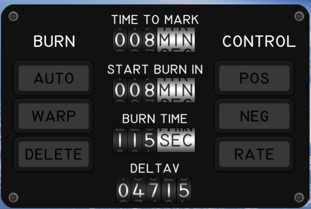
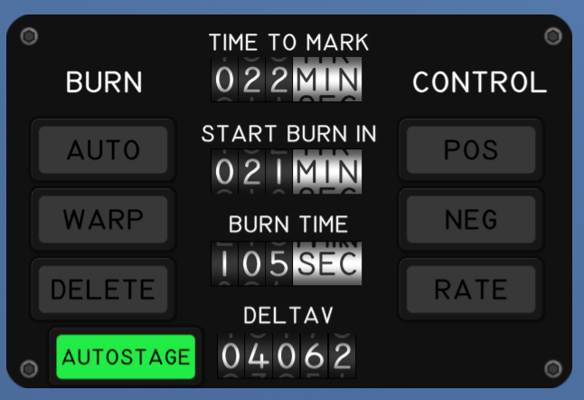

# Burns and staging

## RCS translation burns

Execute a planned burn using RCS thrusters alone, with the main engine suppressed. This is useful for small course corrections (where slewing the craft for the main engine costs more than translating) and for probes without an active main engine.

- **Trigger and override:** The stock **Auto** burn button and **FLY BURN** in the **BURNS** footer trigger the same execution for the next burn. A burn resolves to the main engine when an active, fueled engine exists, and otherwise to RCS. **BURN WITH** on **BURNS** (and on the docked block under the burn editor) sets a per-burn override (**ENGINE/RCS** or **RCS ONLY**).
- **Attitude strategies:** While RCS flies a burn, **ATTITUDE** on **BURNS** selects **Hold** (keep current attitude and translate along the burn vector), **Align** (slew the strongest thruster axis onto the burn vector first) or **FREE** (default: compares total propellant including slew cost and picks the cheaper strategy).
- **Closed-loop execution:** Pulses shrink as remaining delta-v approaches zero and stop within the thrusters' minimum impulse. The main engine autopilot stays suppressed for the entire run.
- **Persistence:** Burns remain in the stock save format; removing AFC keeps all planned burns. RCS arming metadata is stored in `mods\AdvancedFlightComputer\rcs-exec.toml` and survives save/load, including mid-burn.
- **Warnings and refusals:** **BURNS** warns when a burn resolves to RCS with no usable translation thrusters, when estimated propellant exceeds available propellant, or when probe battery power will run out before the burn. Auto refuses a burn with an alert before changing controls if it has zero delta-v, no usable translation or no axis serving its direction.
- **Burn list and docked block:** **BURNS** lists every planned burn; click a row to inspect it. **OPEN AFC** on the docked block under the burn editor (and in the rendezvous burn infobox) opens **BURNS** directly on that burn. The docked block also displays **BURN WITH**, live RCS burn status, **CANCEL** and warnings. Estimates for later burns approximate using the current craft state because stock only loads the first executable burn as active; the footer commit acts only on the next burn.
- **Completion:** An RCS burn finishes like a stock engine auto-burn: time warp stops, the game posts its alert and the next burn loads.
- **Thruster allocator:** **THRUSTER MIX** in **BURNS > GNC** selects **BY AXIS** (default: fires signed-axis groups and lets attitude control counter residual torque) or **MIN FUEL** (solves a fuel-optimal linear program over individual thruster forces and torques, falling back to **BY AXIS** if infeasible).

## Warp to the turn

While stock **AUTO** is armed for the next burn, the console offers **WARP TO TURN** whenever the turn starts more than 90 s away. It warps to 30 s before stock AUTO begins turning the craft so the slew and burn run at 1x while stock AUTO stays armed. Stock **WARP** runs to ignition and turns under warp. **STOP WARP** stops only the warp to the turn.

Before a burn, AFC checks whether the craft can aim it and posts a caution (not a refusal) if it finds a problem:

- **RCS OFF: CRAFT DOES NOT TURN** / **NO RCS FOR PITCH AND YAW** - Stock AUTO uses RCS to slew before ignition. Without active pitch/yaw RCS with propellant, the engine ignites pointed wherever the craft happens to face, or the burn waits.
- **RCS TOO STRONG TO AIM** - One RCS pulse rotates a light craft so quickly that stock AUTO does not start the turn from rest. Use smaller thrusters or more mass.
- **MAY NOT TURN FROM n DEG OFF** - Starting from rest inside that small angle of the burn attitude, stock AUTO does not fire RCS and waits until the craft drifts outside. Point farther away before the turn starts.
- **BURN s, AIM NEEDS s** - The engine needs more time to settle its aim than the burn lasts, leaving a direction error. Check the orbit after the burn.

## Automatic staging

| Stock | With AdvancedFlightComputer |
| :---: | :---: |
|  |  |

AutoStage activates the next sequence when active engines run out of propellant and drops spent boosters while the core keeps firing. It works during both auto-burns and manual burns. Do not install the standalone AutoStage mod alongside AFC; existing AutoStage settings are imported on first load.

- **AUTOSTAGE toggle:** Available on the EngineControl gauge panel (under RCS), at the top of **STAGING** (**AUTOSTAGE THIS CRAFT**), in the console head and in the **MORE** drawer. The switch belongs to the craft, so an armed craft keeps staging while you control another.
- **Control-module guard:** A sequence that would separate the last control module is never staged automatically.
- **Auto-burn continuation:** Keeps stock burn mode on Auto across staging (including manual staging) so planned burns do not abort.
- **Cascade staging:** Stages again automatically if the next sequence is empty or holds only decouplers.
- **Spent stage drop:** Sheds burnt-out boosters as soon as they quit instead of carrying empty casings until the core runs dry. AutoStage checks that the sequence activates no new engine, every active engine it separates is spent, a retained engine is still firing and no retained engine can draw propellant across the separation (nor does an enabled fuel link cross it). Disable with **DROP SPENT STAGES EARLY** on **STAGING** to wait for full burnout.
- **Payload fairing release:** A staging row holding only stock payload fairings (aeroshrouds on stock radial decouplers) is released independently of engine staging. In an atmosphere, release triggers when dynamic pressure is falling at or below **FAIRING RELEASE Q** (default `3 kPa`) and the craft is at least **FAIRING CLEARANCE** (default `30 km`) above terrain. On airless bodies, release triggers while climbing once `20 m` clear of terrain. Both thresholds are set on **LAUNCH** per craft and body. Mixed rows stay with normal staging. If AutoStage is disarmed or release fails, the row returns to the stock staging key. Modded fairings are not auto-released yet.
- **Solid motors in the staging readout:** Stock gives a solid motor the burn time of a full grain on every refresh. AFC paces solid motors at the mean flow of their remaining thrust curve so the staging window and guidance stage list end the booster phase accurately.
- **On-screen countdowns:** Displays "Decouple in X.Xs" and "Ignition in X.Xs" alerts during delayed staging.

### Staging delays

Two delays are configurable per part variant, both measured from the staging trigger: engine ignition delay (defaults per stock engine variant, such as `2 s` for `EngineA1` and `3 s` for `EngineA3`) and decoupler delay (default `0 s`, matching stock). Set the decoupler delay shorter than the engine delay to drop the lower stage before the upper stage ignites.

- **STAGING page:** Holds the AutoStage switches and the **DELAYS** fold (per-sequence delays for this craft, defaults for this craft's parts, and **ALL PARTS** with searchable **ENGINE IGNITION DELAYS** and **DECOUPLER DELAYS** tables). Changes apply immediately; click **SAVE DEFAULTS** to save them. In the editor, **STAGING** shows defaults only.
- **Part window (right-click part > Window):** Override delays for a specific sequence on the current craft, or click **OPEN AFC** to open **STAGING**. Per-craft overrides take priority over global defaults.

Global configuration lives at `mods\AdvancedFlightComputer\autostage.toml` in the active game profile folder:

```toml
[staging]
drop_spent_stages = true

[engine_delays]
CorePropulsionA_Prefab_EngineA2 = 2.0
CorePropulsionA_Prefab_EngineA3 = 5.0

[decoupler_delays]
CoreFairingA_Prefab_Interstage3W3HB = 1.0
```

Per-craft sequence overrides live next to it in `autostage-vehicles\<vehicle-id>.toml` with separate `[sequence_delays]` and `[decoupler_delays]` sections. Nothing is written to a game save.

## Automatic burn removal

KSA deletes a finished auto-burn only when another burn follows it, leaving the final finished burn in the plan. **AUTO REMOVE FINISHED BURNS** (on the **BURNS** page, enabled by default) removes that last finished burn (engine or RCS) on every craft. Manual burns and burns that stopped for lack of propellant stay in the plan. Settings persist in `mods\AdvancedFlightComputer\autoremove.toml`, and settings from the standalone AutoRemoveFinishedBurns mod are imported on first load.
