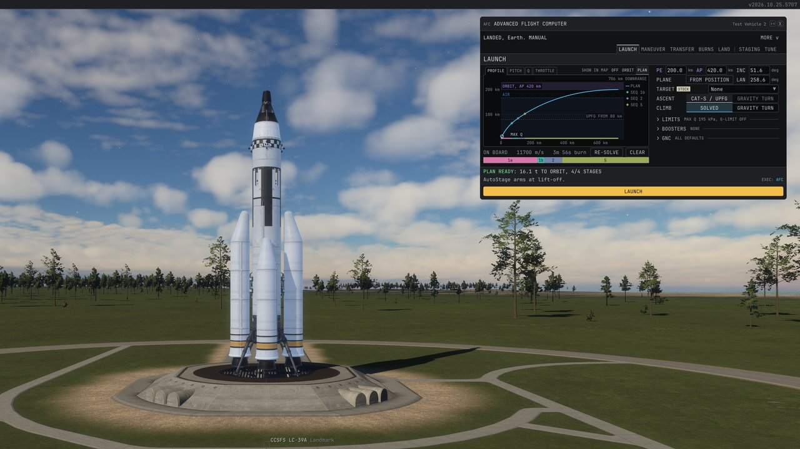
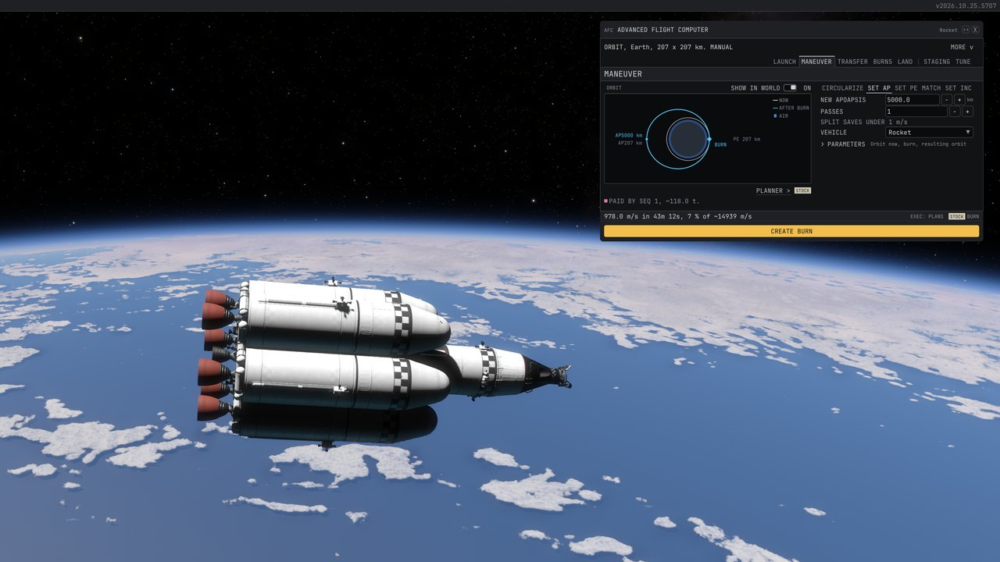
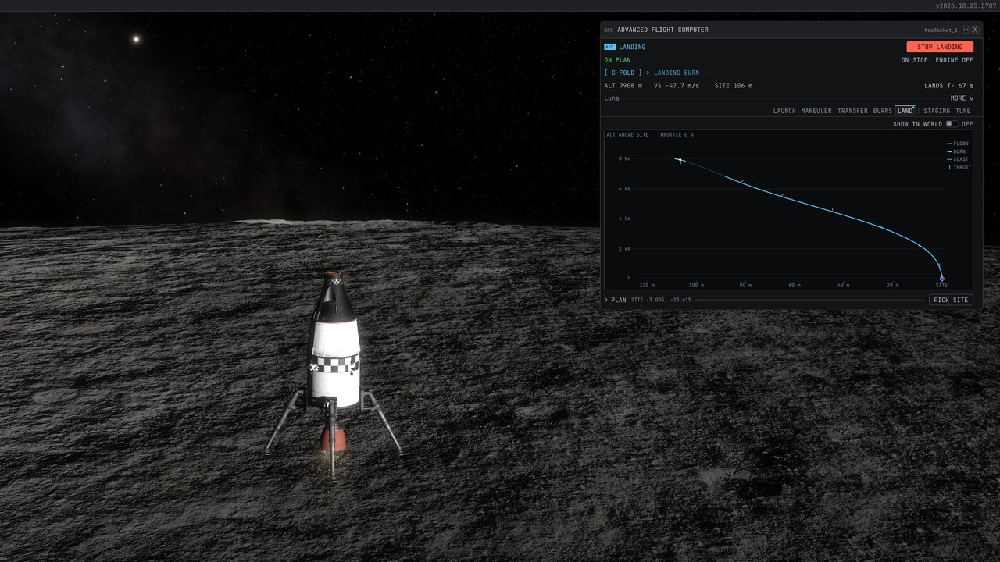

# User Guide

Maneuver planning, burn execution and closed-loop guidance for [Kitten Space Agency](https://ahwoo.com/app/100000/kitten-space-agency).

Adds one AFC console for every feature, orbit quick-tools (circularize, set Pe/Ap, match/set inclination), flyby targeting so a Hohmann transfer arrives as a flyby instead of an impact, multi-pass burn splitting for Oberth-efficient departures, RCS-only burn execution, automatic staging with spent-booster drop and configurable staging delays, automatic removal of finished burns, and enables the planner to target interstellar comets on hyperbolic orbits (Oumuamua, 2I/Borisov, 3I/ATLAS).
Its powered guidance flies an ascent to orbit, a launch to a flyby or an orbit of a moon, a booster boostback and a pinpoint powered landing.

This mod is written against the [StarMap loader](https://github.com/StarMapLoader/StarMap).

Validated against KSA build version 2026.11.25.5949.

## The AFC console at a glance

One window holds every AFC feature. One row of tabs follows the order of a mission, the head says who flies the craft, and one button at the bottom commits the action that fits.

**LAUNCH** plans the climb on the pad and flies it with one press. The plan shows the profile, the stages and the margin.

**MANEUVER** sketches the orbit, the burn bars and the passes of a quick-tool, such as Set Apoapsis, before you create the burn.

**TRANSFER** plans a transfer window on an AFC porkchop plot and draws the transfer in the map.

**LAND** has four ways down: deorbit to a chosen site, boostback of a spent booster, landing from where the craft is, and hover.

The other pages are **BURNS** (how the next burn is flown, with RCS or the main engine), **STAGING** (AutoStage and the staging delays) and **TUNE** (the tuning values and the preferences). See [AFC Console](console.md#afc-console) for the details.
