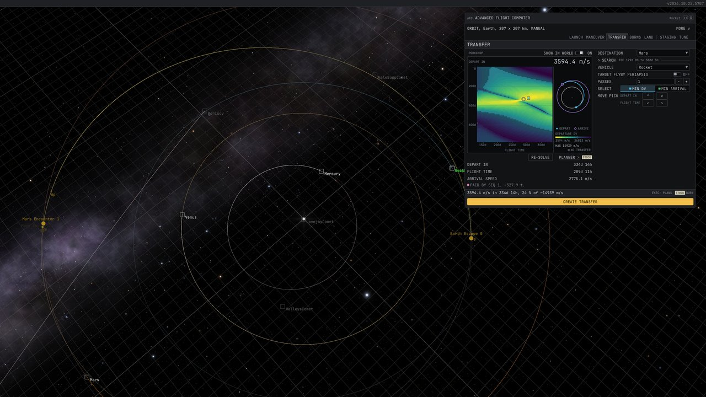
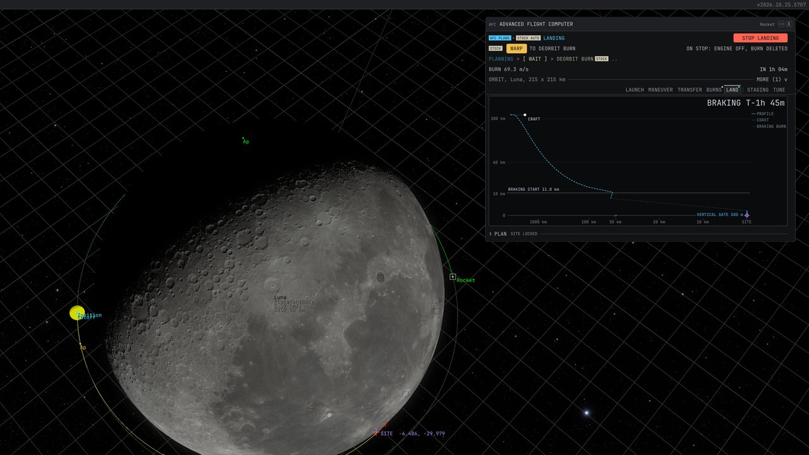

# User Guide

Advanced Flight Computer (AFC) adds maneuver planning, burn execution, automatic staging and closed-loop powered guidance to [Kitten Space Agency](https://ahwoo.com/app/100000/kitten-space-agency) through one console window.

Written against the [StarMap loader](https://github.com/StarMapLoader/StarMap). Validated against KSA build `2026.11.25.5949`.

## What is in this guide

| Page | Covers |
| --- | --- |
| [Installation](installation.md) | Installing AFC, profile folders, runtime and build dependencies. |
| [The AFC console](console.md) | Opening the window, tabs, head status, drawer, footer commits, strip and warning bands. |
| [Maneuvers and transfers](maneuvers.md) | Orbit quick-tools, porkchop transfers, flyby targeting, multi-pass burns and hyperbolic comets. |
| [Burns and staging](burns-and-staging.md) | RCS-only burns, warp to the turn, AutoStage, fairing release, staging delays and burn removal. |
| [Powered guidance](powered-guidance.md) | Ascent, launch to a moon, booster return, entry, touchdown landing, landing engines and hover. |
| [Landing sites for mod authors](landing-sites.md) | Adding named pads and landing barges via `AfcLandingSites.toml`. |
| [Compatibility and credits](about.md) | Standalone mod replacements, credits, licenses and community links. |

## The AFC console at a glance

One window holds every AFC feature. A single row of tabs follows the order of a mission, the head shows who flies the craft, and one button at the bottom commits the action that fits.

**LAUNCH** plans the climb on the pad and flies it with one click. The plot shows the trajectory profile, stages and fuel margin.

**MANEUVER** sketches the orbit, burn bars and passes of a quick-tool, such as Set Apoapsis, before you create the burn.

**TRANSFER** plans a transfer window on an AFC porkchop plot and draws the transfer in the map.

**LAND** has four ways down: deorbit to a chosen site, boostback of a spent booster, landing from where the craft is now, and hover.

Touchdown guidance (6-DOF) is the primary landing solver, with entry guidance (3-DOF) ahead of it in an atmosphere and G-FOLD as the airless fallback.

The remaining tabs are **BURNS** (engine or RCS burn execution and automatic burn removal), **STAGING** (AutoStage and staging delays) and **TUNE** (guidance tuning, diagnostics and preferences). See [The AFC console](console.md) for the full layout.
