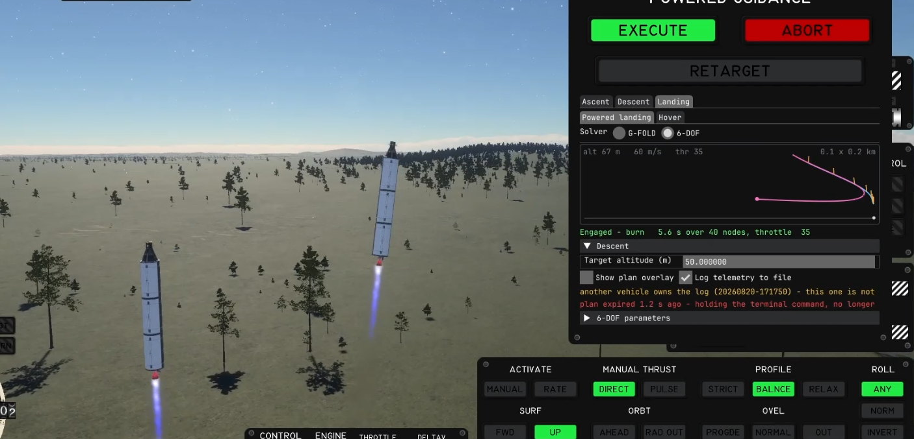

# Powered guidance

Closed-loop guidance that flies ascent, booster return, entry and powered landing automatically. Originally developed by cairn5 as [PoweredGuidance](https://github.com/cairn5/PoweredGuidance); see [Credits](about.md#credits).

Use the **LAUNCH** and **LAND** pages of the [AFC console](console.md). The page footer commits the active mode, and the head stop acts on whichever mode is running. Toggle **GUIDANCE ENABLED** in the **AFC** top-bar menu or on **TUNE > PREFERENCES** to disable or enable guidance globally.

## Ascent

**LAUNCH** flies either **UPFG** (the Space Shuttle's ascent guidance) or **convex ascent** to a target periapsis, apoapsis, inclination and LAN. You can optionally hold the argument of periapsis (otherwise insertion happens where delta-v cost is lowest), set a launch window, set a g-limit and reserve propellant for a returning booster.

- **Target rendezvous:** Launching to a target craft flies a co-elliptic chase orbit below it.
- **Plane and window checks:** **LAUNCH** refuses an inclination the launch site cannot reach (and names the nearest reachable inclination) and refuses a target-plane launch outside its window (and reports the next window time).
- **Attitude and fins (`LAUNCH > GNC`):** **AFC ATTITUDE CONTROL** (on by default) lets AFC steer ascent with gimbals first and RCS for the remainder against aerodynamic moments; switching it off hands attitude steering to the stock flight computer. **STEER WITH FINS** (off by default) lets AFC include aerodynamic control surfaces during ascent.
- **Staging and fairings:** Staging runs through [automatic staging](burns-and-staging.md#automatic-staging), including independent payload fairing release.

## Launch to a moon

**THEN** on **LAUNCH** picks what follows the ascent: *Stay in orbit*, a flyby of a moon or an orbit of a moon (every moon of the launch body is listed), with **PERIAPSIS AT MOON** below it (`100 km` by default).

- With a moon picked and no **TARGET**, AFC sets the launch plane for the moon and arms **LAUNCH** for its window: the moon's own plane when the launch site passes under it, or the plane just above the site's latitude that reaches the moon soonest.
- After ascent, AFC plans the injection burn from the parking orbit, verifies the flown orbit and plans up to two small mid-course corrections (a `0.1 m/s` injection error can move moon periapsis by more than `100 km`). For a moon orbit, AFC then plans the capture burn at periapsis (circular, or elliptical if delta-v is limited).
- Stock **AUTO** flies each burn and AFC warps to each one for the focused craft. If stock's low-battery warning interrupts an AFC warp during a moon chain or deorbit, AFC offers to resume warp.
- Planning a manual burn, editing or deleting a chain burn, turning **AUTO** off, switching **THEN** back to *Stay in orbit*, starting another controller or disabling guidance stops the chain and leaves unexecuted burns planned with **AUTO** off.
- A parking orbit far out of the moon's plane is refused with the plane angle and delta-v cost.

## Booster return and boostback

A stage that separates with a command pod can fly back to a landing site after separation:

- Under **LAUNCH > BOOSTER RETURN**, assign each returnable stage either a named landing site (**RETURN TO**) or **OPTIMAL RETURN** (places a downrange drone-ship target during the climb solve and freezes it at lift-off). AFC sizes the booster fuel reserve from the solved climb.
- **LAND > BOOSTBACK** flies a separated booster back toward its target site with a settling burn, flip, boostback burn and entry attitude guided by an atmospheric impact predictor.
- With **ENTRY ON GLIDE** enabled, entry guidance takes over the boostback glide automatically and flies the landing burn.

## Landing and deorbit

**LAND** provides four ways down, all sharing the selected landing site (see [Landing sites for mod authors](landing-sites.md) to add custom pads or barges):

- **DEORBIT** flies the full chain from orbit: deorbit burn, powered descent with **touchdown guidance** (the 6-DOF solver) and a terminal hover to touchdown for craft that can hover. On **DEORBIT > AFTER DEORBIT**, you can choose **LAND** or **ENTRY BURN ONLY** (with an **ENTRY PERIAPSIS** in km). In **ENTRY BURN ONLY** mode, the commit button becomes **DEORBIT ONLY**, stock **AUTO** flies the entry burn, and AFC releases control for a parachute descent. On atmospheric bodies, **DEORBIT + LAND** directs you to use **DEORBIT ONLY** and then **LAND NOW** in air.
- **LAND NOW** starts landing from the current state, using **touchdown guidance** directly or **entry guidance** (the 3-DOF solver) first when falling through an atmosphere.
- **Entry guidance (3-DOF)** flies the unpowered atmospheric glide, ignites at the planned time and flies the landing burn. With **TOUCHDOWN FOR BURN END** enabled, touchdown guidance takes over the final seconds of the burn.
- **Touchdown guidance (6-DOF)** models vehicle rotation, handling high-inertia boosters, atmospheric descents and RCS-only craft (no gimbal required). Its plan ends where the lowest point of the craft meets the ground, so craft that cannot hover still touch down softly. Craft without engine roll torque land upright at whatever heading and roll rate they arrive with.
- **G-FOLD fallback:** If touchdown guidance has no plan in the air for `6 s`, G-FOLD (a point-mass solver) takes over automatically if the craft qualifies (airless body, throttling liquid engines and a gimbal). AFC refuses before the deorbit burn if neither solver can fly the craft and states why.
- **Landing legs (`LAND > LEGS`):** Deploys landing legs when time to touchdown on the active plan's clock equals leg deploy time plus **BUFFER** (`1.0 s` default).
- **Gimbal-only burn steering:** With **STEER BURN WITH GIMBAL** enabled (default, under **LAND > DEORBIT > GNC**), a landing burn on gimballed engines with pitch/yaw authority switches RCS off during the burn so the gimbal steers alone, then restores RCS when the engine shuts off or the mode ends.
- **Post-touchdown attitude:** After touchdown, attitude remains in **MANUAL** so RCS does not push the landed craft.

## Landing engines

Choose which engines fire for landing without changing launch or boostback staging. Open **LANDING ENGINES** on **LAND** or on a booster row under **LAUNCH > BOOSTER RETURN**:

- **Aft engine map:** Shows an aft-view diagram of the craft's engines (`LANDS`, `STAYS OFF`, `NO GIMBAL`, `IN THE CHOICE`, plus live `SWITCHED ON`, `FIRING`, `NO PROPELLANT`). Click any engine dot to toggle it directly (custom selections appear as `CUSTOM N`).
- **Automatic suggestions:** A table lists **AS STAGED** alongside symmetric engine subsets with engine count (`N`), `HOVER` TWR, `BRAKE` TWR, a verdict (`OK`, `NO HOVER`, `WEAK`, `TOO WEAK`, `OFF AXIS`) and a `BEST` marker. Click any row to select it immediately.
- **Manual flight and staging:** During manual flight on **LAND**, click **APPLY NOW** to switch on the chosen landing engines immediately (stock engine switch and throttle still control firing). For a returning booster, AFC activates the selected landing engines during the glide, verifies propellant and uses them for entry and touchdown.
- **PARK IDLE ENGINES:** Tilts the nozzles of unlit engines outward away from lit engines during a landing burn (visual only; lit engines steer normally).

## Hover

**LAND > HOVER** holds a controlled terminal hover and descends to touchdown. Hover refuses craft whose thrust at minimum throttle exceeds weight (`TWRmin > 1`), because such craft climb whenever lit; G-FOLD and touchdown guidance fly those craft directly to touchdown instead of handing over to hover.

Use the console nudge buttons to shift the hover aim. Numpad nudges are off by default because KSA uses numpad digits for HUD layouts; enable **NUMPAD NUDGES THE HOVER** on **TUNE > PREFERENCES** to nudge with the numpad while hovering regardless of the active console page.

## Control, aborts and saved settings

- **Limits:** Guidance plans respect both the configured g-limit and KSA's structural load throttle limit.
- **Control and takeovers:** Guidance claims a craft only when you click a page commit button and releases it on abort, manual attitude takeover or arming a stock Auto burn. A commit that would take a craft from another running guidance mode asks first.
- **Aborts:** Aborting during powered descent, terminal hover or an entry landing burn leaves the engine throttle as-is so the craft does not drop. All other aborts (including aborting entry guidance during the unpowered glide) cut the engine.
- **Time warp during solves:** AFC holds simulation speed at 1x while solving a launch plan or planning a deorbit burn, then restores your previous speed unless entering a burn, armed launch or coast to a planned burn.
- **Countdown and diagnostics:** A green `SEPARATION T-` band appears under the altitude counter before stage separation even with the console closed. Detailed solver telemetry lives under **TUNE > DIAG** (`ASCENT`, `BOOSTBACK`, `AERO`, `ATMOSPHERE`, `G-FOLD`, `LOG`, `FLIGHT PLAN`).
- **Saved settings:** Per-craft settings on **LAUNCH**, **LAND** and **TUNE** (target orbit, ascent method, **THEN**, landing site, legs, **PLAN ON MAP** and non-default tuning values) are saved with the game save in `afc-craft-settings.toml` and restored on load (even after renaming the craft), without auto-starting any mode. LAN is not saved because it starts over the launch site. Global UI preferences (**SHOW IN MAP**, **SHOW IN WORLD**, console layout) are saved in `ui.toml`.

The native solvers `clarabel_c.dll` and `scs.dll` ship with the mod. See the [guidance developer documentation](../guidance/README.md) for the solver architecture and mathematics.
